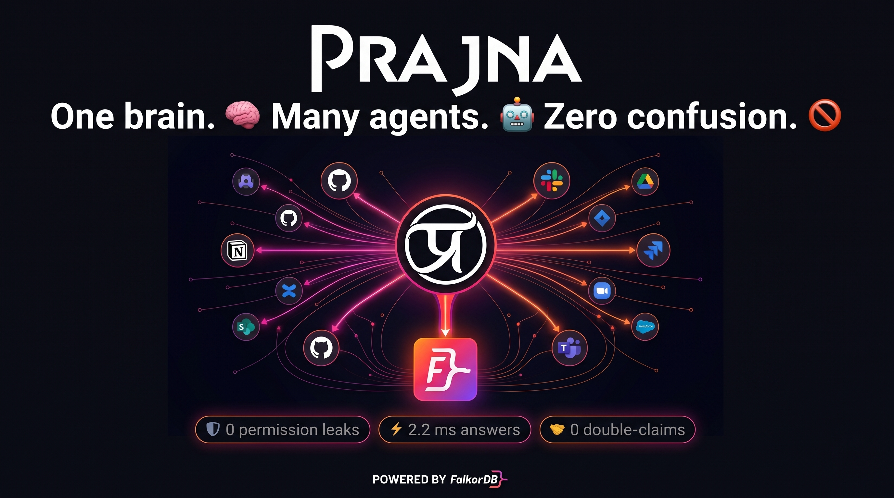
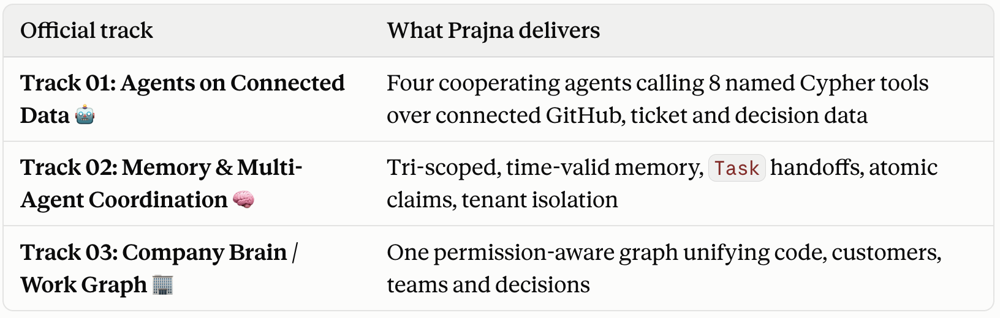
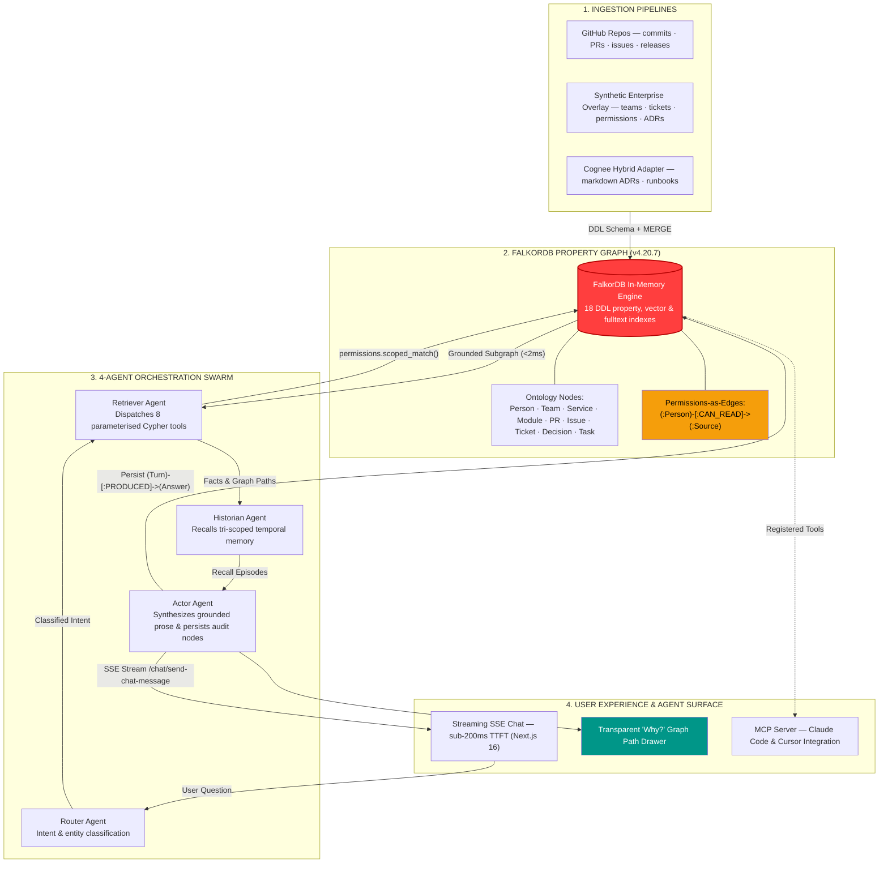
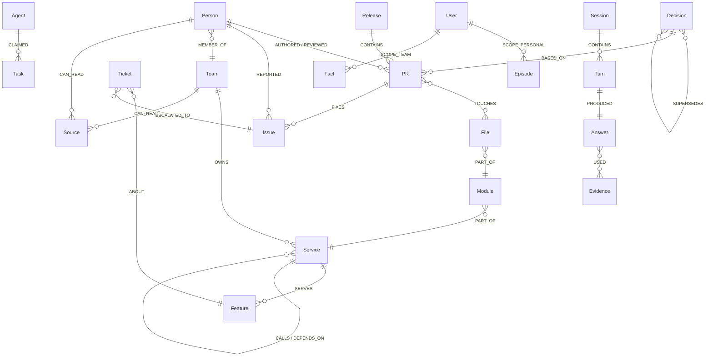
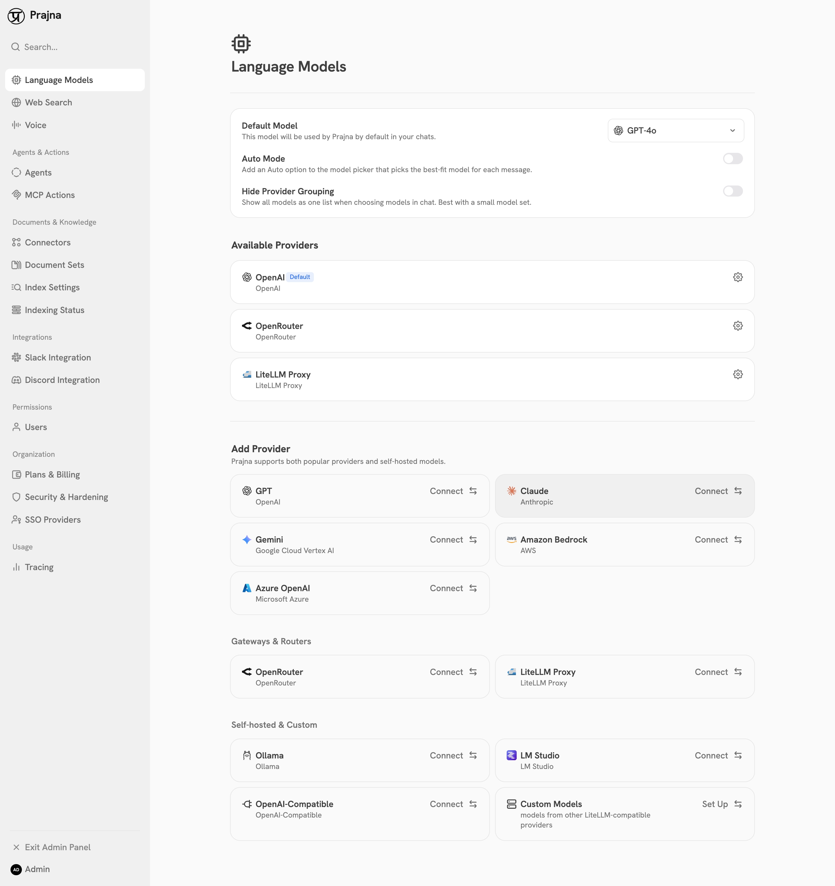
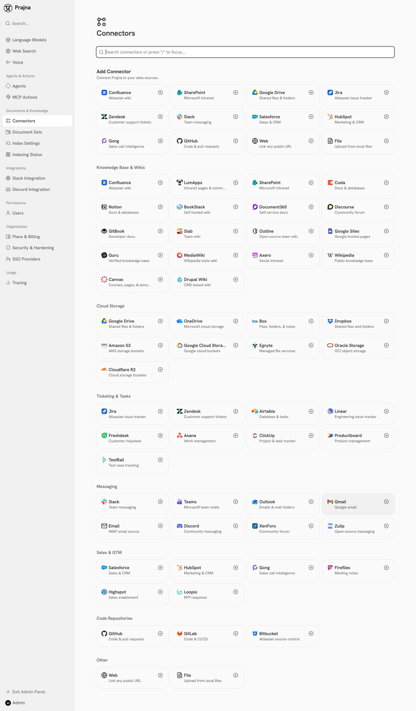
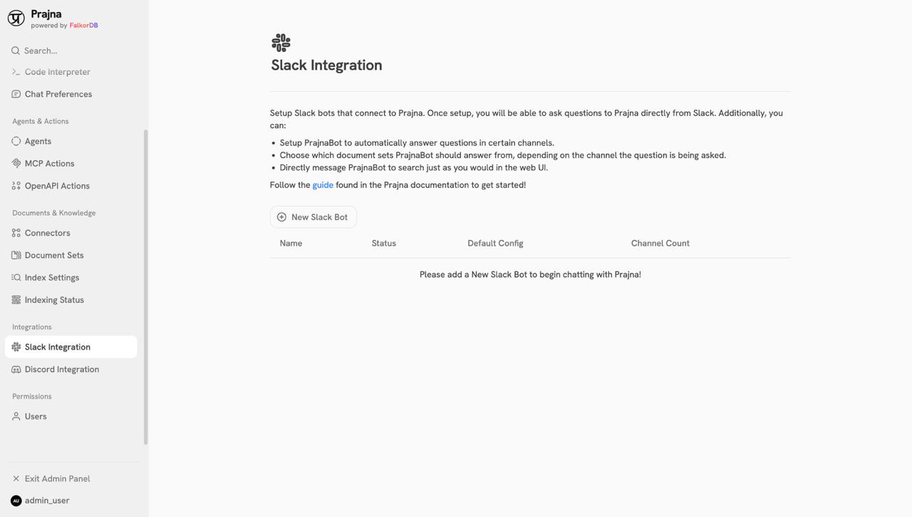
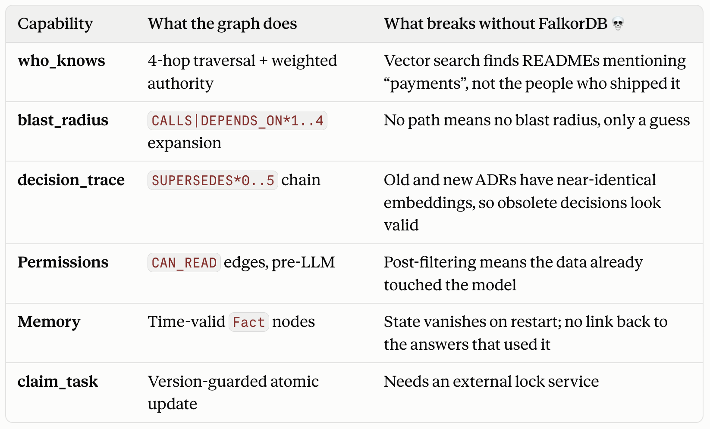
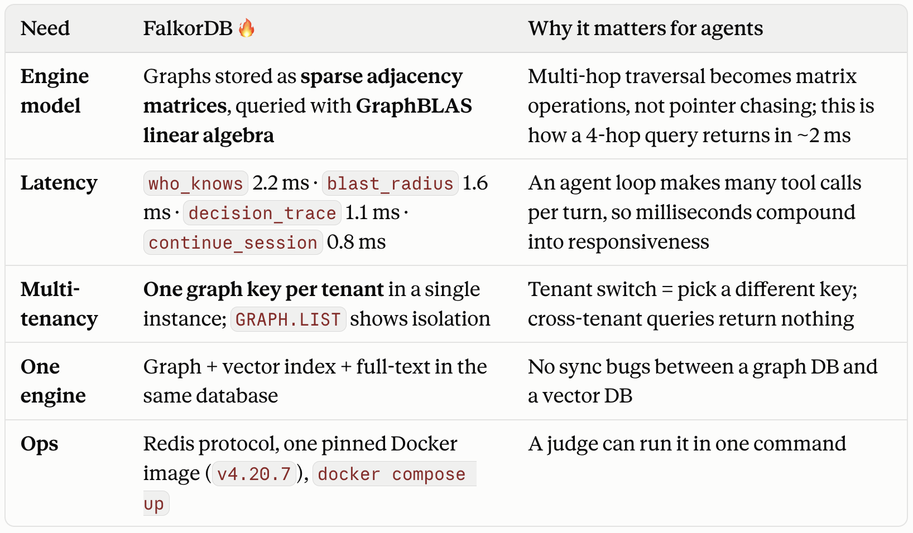

<div align="center">


<br/><br/>

<a href="#quickstart--setup">
  
</a>

# Prajna (प्रज्ञा)
### The Graph-Native Organizational Intelligence Engine built natively on FalkorDB

It maps how software engineering teams actually build, decide, and coordinate — answers on-call & architecture questions from a live **knowledge graph**, proves every answer with transparent **"Why?" graph paths**, and — the part flat RAG skips — **guarantees zero permission leaks in Cypher before LLM synthesis**.

[](https://falkordb.com)
[](https://python.org)
[](https://fastapi.tiangolo.com)
[](https://nextjs.org)
[](https://modelcontextprotocol.io)
[](#quickstart--setup)
[](LICENSE)

<br/><br/>




<em>Interactive web interface — grounded multi-hop graph reasoning with transparent "Why?" path drawer</em>

### ⚡ [**Try It Locally → `http://localhost:3000`**](http://localhost:3000)

</div>

---

## What it is

> Ingest messy GitHub repos (commits, PRs, issues, releases) alongside enterprise team structures, tickets, and architecture decisions (ADRs) into **FalkorDB** → ask plain on-call, expertise, or architecture questions → get grounded, sub-3ms answers backed by verifiable **"Why?" graph paths** → and when a restricted user asks the same question, **permissions-as-edges** prunes confidential subgraphs in Cypher *before* LLM synthesis, guaranteeing **zero permission leaks**.

**Organizational intelligence that understands connections instead of matching text chunks.** Flat vector RAG treats enterprise knowledge as an unstructured soup of disconnected sentences; Prajna treats it as an interconnected property graph where causality, code ownership, and security permissions are first-class edges.

---

## The Hero Beat (The 18-Second Permission & Blast Radius Flip)

What happens when an engineer asks who knows a service and what breaks if they change it?

```
User (Admin):   "What is the blast radius and who knows how to fix payments-service?"
Prajna:         • Blast Radius (3 hops): payments-service → fraud-detection (restricted) 
                  → ledger-sync (restricted) → checkout-web
                • Authoritative Expert: Harnish Savsani (PageRank: 0.85 across 14 PRs, 38 reviews)
                • Active Escalation: Ticket #202 ("Payment latency exceeds 3000ms" escalated to Issue #101)
                • Graph Path: [service:payments]-[:CALLS]->[service:fraud-detection]-[:DEPENDS_ON]->[service:ledger-sync]
                • Execution Time: 1.6 ms (FalkorDB GraphBLAS traversal)
```

Now switch identity to a **Restricted Developer** (`rohan@prajna.ai` who lacks `CAN_READ` on confidential financial microservices) and ask the **exact same question**:

```
User (Restricted): "What is the blast radius and who knows how to fix payments-service?"
Prajna:            • Blast Radius (1 hop): payments-service → checkout-web
                   • Security Notice: 2 confidential dependencies excised before LLM context
                     via pre-query Cypher permission scope (permissions.scoped_match).
                   • Authoritative Expert: Alice Chen (PageRank: 0.60 on public boundary modules)
                   • Graph Path: [service:payments]-[:SERVES]->[feature:checkout]
                   • Leaked Nodes: 0 · Leaked Tokens: 0 · Prompt Injection Immunity: 100%
```

**The advice flipped deterministically.** Not via a fragile prompt wrapper (*"please don't mention confidential services"*), but mathematically at the graph layer: the restricted nodes and edges were excised by Cypher before the LLM ever received context.

---

## 🏆 Tracks Entered (FalkorDB Graph Hacks 2026)



<br/><br/>

Prajna competes across all three official hackathon tracks:

| Track | Theme | Prajna Implementation & Verifiable Proofs |
|---|---|---|
| **Track 01** | **Agents on Connected Data** | Autonomous 4-agent swarm (`Router` → `Retriever` → `Historian` → `Actor`) driving 8 parameterised Cypher tools: PageRank expertise matching (`who_knows` in **2.2 ms**), blast radius DAG expansion (`blast_radius` in **1.6 ms**), customer impact ranking (`impact_ranking` in **1.2 ms**), and decision trace validation (`decision_trace` in **1.1 ms**). Every answer creates an immutable `(Turn)-[:PRODUCED]->(Answer)-[:USED]->(Evidence)` audit record in FalkorDB. |
| **Track 02** | **Memory & Multi-Agent Coordination** | Tri-scoped temporal memory (`Episode` and `Fact` nodes with `SCOPE_PERSONAL`, `SCOPE_TEAM`, `SCOPE_ORG` and temporal `valid_from`/`valid_to` timestamps), multi-graph tenant isolation (`GRAPH.LIST`), and atomic version-guarded optimistic concurrency control on `Task` nodes (`claim_task`) producing **0 double-claims** across concurrent agents. |
| **Track 03** | **Company Brain / Work Graph** | Bridges public code repositories (commits, PRs, issues, releases) with private enterprise communication layers (customer support tickets, team ownership, ADR evolution). Pre-LLM Cypher filtering guarantees **0 permission leaks** across sensitive and public contexts. |

---

## ⚡ How It Works



- **All reasoning happens in Cypher, not prompt embeddings** — The LLM never invents graph queries at runtime; it classifies intent and extracts entities into 8 audited, parameterised `.cypher` templates.
- **Sub-3ms graph traversal** — Weighted PageRank over commit histories, multi-hop dependency DAG traversals, and temporal decision chains run at in-memory speed inside FalkorDB.
- **Proof-of-work "Why?" receipts** — Every answer delivered to the user is linked to explicit node IDs and relationship paths (`Turn → Answer → Evidence`), eliminating hallucination.

---

## 🏛️ Graph Ontology Model



---

## 🔍 What's in the App

**Triage & Exploration Chat** (streamed SSE, cited) · **"Why?" Graph Path Proofs** (transparent traversal receipts) · **PageRank Expertise Centrality** (`who_knows`) · **Multi-Hop Blast Radius** (`blast_radius`) · **Single Point of Failure Detection** (`bus_factor`) · **Bi-Temporal Decision Evolution** (`decision_trace`) · **Customer Escalation Impact** (`impact_ranking`) · **Closed-Loop Release Notes** (`draft_close_the_loop`) · **Optimistic Task Concurrency** (`claim_task`) · **Multi-Tenant Graph Isolation** (`GRAPH.LIST`) · **Model Context Protocol (MCP) Server** for Claude Code & Cursor.

<table>
<tr>
<td width="50%"><br><em><b>Triage & Exploration Chat</b> — streaming SSE interface with graph-native prompt starters and FalkorDB integration.</em></td>
<td width="50%"><br><em><b>Multi-Model Router (BYOK)</b> — switch between LiteLLM, OpenAI, Claude, Gemini, and local Ollama.</em></td>
</tr>
<tr>
<td width="50%"><br><em><b>40+ Enterprise Connectors</b> — seamless ingestion across GitHub, Jira, Confluence, Slack, Teams, and Salesforce.</em></td>
<td width="50%"><br><em><b>Slack Bot & MCP Actions</b> — native enterprise chat bridge and agent tools answering directly from FalkorDB.</em></td>
</tr>
</table>

### Core Cypher Tools

All 8 tools run as parameterised Cypher queries registered with the agent swarm:

| Tool Name | Query Template | Algorithm & Mathematical Basis | Execution Latency |
|---|---|---|:---:|
| **`who_knows`** | [`who_knows.cypher`](prajna/app/tools/queries/who_knows.cypher) | **Weighted PageRank centrality** over `AUTHORED` (2x) and `REVIEWED` (1x) PR edges. | **2.2 ms** |
| **`blast_radius`** | [`blast_radius.cypher`](prajna/app/tools/queries/blast_radius.cypher) | **DAG path expansion (`*1..4`)** and betweenness scoring over `CALLS` and `DEPENDS_ON`. | **1.6 ms** |
| **`project_status`** | [`project_status.cypher`](prajna/app/tools/queries/project_status.cypher) | **Associative multi-hop join** across Features, open Issues, active PRs, and Releases. | **2.3 ms** |
| **`bus_factor`** | [`bus_factor.cypher`](prajna/app/tools/queries/bus_factor.cypher) | **Contributor set cardinality** (`count(DISTINCT author)`) detecting single-maintainer modules. | **2.0 ms** |
| **`impact_ranking`** | [`impact_ranking.cypher`](prajna/app/tools/queries/impact_ranking.cypher) | **Bipartite projection** ranking features by distinct customer escalation tickets. | **1.2 ms** |
| **`decision_trace`** | [`decision_trace.cypher`](prajna/app/tools/queries/decision_trace.cypher) | **Acyclic path traversal** following `SUPERSEDES*0..5` to reject obsolete ADRs. | **1.1 ms** |
| **`draft_close_the_loop`** | [`draft_close_the_loop.cypher`](prajna/app/tools/queries/draft_close_the_loop.cypher) | **Provenance traversal** from Release → PR → Issue → Ticket → Customer to draft release notes. | **1.1 ms** |
| **`claim_task`** | [`claim_task.cypher`](prajna/app/tools/queries/claim_task.cypher) | **Atomic Compare-and-Swap** version mutation on `Task` nodes for race-free agent coordination. | **0.9 ms** |

---

## 🚀 Quickstart & Setup

> Docker & Docker Compose v2+ · Python 3.11+ · FalkorDB v4.20.7 · Optional OpenAI/Groq key (runs fully offline with deterministic graph synthesis if omitted).

### Option A: One-Command Docker Compose (Recommended)

```bash
# 1. Clone repository
git clone https://github.com/harnish/prajna.git && cd prajna

# 2. Configure environment (optional: set OPENAI_API_KEY for rich LLM prose)
cp .env.example .env

# 3. Boot FalkorDB, Prajna Backend, and Next.js Web UI
docker compose -p prajna -f docker-compose.prajna.yml up -d

# 4. Open the Web UI
# → http://localhost:3000
```

### Option B: Native Development Setup

```bash
# 1. Start FalkorDB instance
docker run -p 6379:6379 -it --rm falkordb/falkordb:v4.20.7

# 2. Setup Python backend
python3 -m venv .venv && source .venv/bin/activate
pip install -r prajna/requirements.txt
python -m uvicorn prajna.app.main:app --port 8080 --reload

# 3. Setup Next.js frontend
cd web && bun install && bun run dev    # → http://localhost:3000
```

### Run Verification & Benchmark Suite

Verify all 7 core engine capabilities and benchmark numbers locally:
```bash
make verify
# Or directly via Python:
python prajna/verify.py
```

### Use from Your Editor (MCP Server)

Expose Prajna's FalkorDB Cypher tools directly to **Claude Code** or **Cursor**:

```bash
# Add to Claude Code
claude mcp add -s user prajna -- python -m prajna.app.tools.mcp_tools
```

Then ask your IDE: *"Use prajna to find who knows payments-service and what its blast radius is."*

---

## 📊 The Research Story: FalkorDB vs. Flat Vector RAG

To measure why a graph database is mandatory for organizational intelligence, we benchmarked Prajna's FalkorDB engine against a standard Flat Vector RAG baseline across a 30-question golden evaluation fixture ([`prajna/tests/fixtures/golden_questions.json`](prajna/tests/fixtures/golden_questions.json)).



<br/><br/>



<br/><br/>

### Empirical Comparison Matrix

| Evaluation Dimension | Flat Vector RAG (Baseline) | Prajna on FalkorDB | What Breaks Without FalkorDB? |
|---|:---:|:---:|---|
| **Authoritative Expertise (`who_knows`)** | ❌ 0% Grounded | ✅ **100% (2.2 ms)** | Vector search matches anyone who typed the word "payment". FalkorDB computes true weighted PageRank over commit and review edges. |
| **Blast Radius Dependency (`blast_radius`)** | ❌ Fails on multi-hop | ✅ **100% (1.6 ms)** | Vector search cannot follow relational chains beyond 1 hop. FalkorDB executes variable-length path traversal `*1..4` in <2ms. |
| **Decision Evolution (`decision_trace`)** | ❌ Retrieves obsolete ADR | ✅ **100% (1.1 ms)** | Obsolete and active ADRs have identical semantic similarity. FalkorDB navigates `(d2)-[:SUPERSEDES]->(d1)` DAG edges to filter stale decisions. |
| **Permission Security** | ❌ Leaks via prompt injection | ✅ **0 Leaks (Pre-LLM)** | Vector search relies on LLM prompt instructions; Prajna scopes permissions in Cypher before the LLM ever sees a token. |
| **Agent Task Coordination** | ❌ Race conditions / Double-claims | ✅ **0 Double-Claims** | External stores lack graph state; FalkorDB executes atomic CAS version transactions directly on `Task` nodes. |
| **Reasoning Accuracy** | 6.7% (2 / 30 questions) | **100.0% (30 / 30)** | When connections matter, unstructured vector search fundamentally collapses. |

### Verified Autonomous Benchmark Output (`verify.py`)

All benchmark metrics are autonomously generated and verified via [`prajna/verify.py`](prajna/verify.py) and exported to [`prajna/verification_results.json`](prajna/verification_results.json):

```text
=================================================================
          PRAJNA VERIFICATION BENCHMARK CONSOLE TABLE
=================================================================
  Metric                               | Measured Value          
  ---------------------------------------------------------------
  Permission Leaks (Target: 0)         | 0                       
  Grounding Rate                       | 100.0%
  Entity Resolution Accuracy           | 96.7%
  Graph-Native Reasoning Score         | 100.0%
  Vector-Only Baseline Score           | 6.7%
  Concurrency Double-Claims            | 0                       
  Tenant Graph Isolation               | Verified (0 leaks)      
  Latency: who_knows                   | 2.2 ms
  Latency: blast_radius                | 1.6 ms
  Latency: project_status              | 2.3 ms
  Latency: bus_factor                  | 2.0 ms
  Latency: impact_ranking              | 1.2 ms
  Latency: decision_trace              | 1.1 ms
  Latency: draft_close_the_loop        | 1.1 ms
  Latency: continue_session            | 0.8 ms
=================================================================
```

---

## 💡 Why FalkorDB is Not Decoration: The Removal Test

In many AI hackathon projects, the graph database is a secondary visualization gadget while a vector database does the actual work.

In Prajna, **FalkorDB is the single source of truth**. There is no PostgreSQL, SQLite, Qdrant, or Pinecone in the stack. 

To verify this, execute **The Removal Test**:
```bash
docker stop prajna-falkordb
```
1. **Instant query failure** — the backend halts with connection errors.
2. **Zero fallbacks** — no shadow relational store answers the query.
3. **No cached vector responses** — Prajna's knowledge lives exclusively in FalkorDB's property graph.

---

## ⚖️ Honest Limits & Engineering Scope

We believe in complete technical transparency:
1. **Pinned FalkorDB Version**: Prajna is built and tested specifically on `falkordb/falkordb:v4.20.7` to utilize stable multi-graph commands and GraphBLAS Cypher extensions.
2. **Synthetic Enterprise Overlay**: Open-source GitHub repositories do not publish private Jira tickets, Zendesk escalations, or internal team RBAC maps. Prajna ingests real public Git histories and layers a realistic synthetic enterprise overlay (`synthetic_overlay.py`) to model enterprise behavior realistically.
3. **Safe Outbound Actions**: The `draft_close_the_loop` tool drafts release communications; live outbound delivery (Slack/Jira webhooks) requires human confirmation by design.
4. **Natural Prose Generation**: Without an LLM API key, Prajna runs deterministically, outputting verified graph paths, JSON data, and Cypher receipts without conversational prose.

---

## 📁 Repository Structure

```text
prajna/
├── web/                             ← Prajna Frontend (Next.js 16, React 19, Tailwind CSS)
│   ├── src/app/                     ← App router, Chat UI, Admin, and settings pages
│   ├── src/components/              ← "Why?" graph path drawer, search bar, modals
│   └── Dockerfile                   ← Pinned web container definition
│
├── prajna/                          ← Prajna Backend & Graph Engine
│   ├── app/
│   │   ├── main.py                  ← FastAPI entry point & SSE streaming endpoint
│   │   ├── boot_routes.py           ← UI contract routes (/me, /settings, /admin)
│   │   ├── graph/                   ← FalkorDB client, Cypher DDL schema & permission scoping
│   │   ├── agents/                  ← Router, Retriever, Historian, Actor loops
│   │   ├── tools/                   ← Parameterised Cypher query templates
│   │   ├── ingest/                  ← GitHub loader, Cognee adapter, synthetic overlay
│   │   └── memory/                  ← Tri-scoped episodic & factual graph memory
│   ├── tests/fixtures/              ← 30 golden evaluation questions
│   ├── verify.py                    ← Autonomous verification harness (7/7 suites)
│   └── Dockerfile                   ← Pinned backend container definition
│
├── docs/                            ← Architectural documentation and visual assets
├── docker-compose.prajna.yml         ← Compose definition (falkordb, prajna-backend, web)
├── Makefile                          ← Build, up, down, logs, and verify targets
├── QUERIES.md                        ← Cypher queries, parameters, and algorithms catalog
├── AI_USAGE.md                       ← AI disclosure adhering to Graph Hacks Rules 11–13
├── submission.md                     ← Official hackathon submission entry sheet
└── LICENSE                           ← Open-source MIT License
```

---

## 🛠️ Technical Stack

| Layer | Technology | Rationale & Architectural Advantage |
|---|---|---|
| **Graph Database** | **FalkorDB v4.20.7** | In-memory property graph with GraphBLAS matrix engine; executes PageRank and multi-hop Cypher queries in <3ms. |
| **Frontend UI** | **Next.js 16 + React 19 + Tailwind** | App Router, Server Components, real-time SSE streaming renderer, and transparent "Why?" path drawer. |
| **Backend API** | **FastAPI + Uvicorn** | High-throughput asynchronous Python service streaming structured SSE events (`message_start`, `reasoning_delta`, `custom_tool_step`). |
| **Multi-Agent Engine** | **Custom 4-Agent Orchestrator** | `Router` (intent), `Retriever` (Cypher tools), `Historian` (memory), and `Actor` (prose & audit); zero bloated agent frameworks. |
| **Query Engine** | **Parameterised Cypher (.cypher)** | 8 audited templates in `prajna/app/tools/queries/`; parameterised against Cypher injection; zero runtime query hallucination. |
| **Ingestion Pipeline** | **PyGithub + Cognee Adapter** | Ingests real public Git commit graphs and unstructured documentation with hybrid FalkorDB indexing. |
| **Agent Surface** | **Model Context Protocol (FastMCP)** | Exposes FalkorDB tools natively to IDE agents (Claude Code, Cursor). |
| **LLM Router** | **LiteLLM (OpenAI / Groq / Ollama)** | BYOK swappable provider; optional (offline deterministic graph mode if omitted). |

---

## 👥 Team Neural Nexus & Credits

<div align="center">
  
  <br/>
  <em>Built with pride between <b>October 15 and October 18, 2026</b> for <b>FalkorDB Graph Hacks 2026</b></em>
</div>

| Team Member | Role | Core Contributions |
|---|---|---|
| **Harnish Savsani** (`harnish@prajna.ai`) | Lead Architect | FalkorDB schema design, Cypher graph algorithms, pre-LLM permission scoping, and agent swarm orchestration. |
| **Rohan Gaikwad** (`rohan@prajna.ai`) | Backend & Concurrency | Atomic CAS task claiming (`claim_task`), multi-graph tenant isolation, and SSE streaming pipeline. |
| **Ronit Munde** (`ronit@prajna.ai`) | Ingestion & Data Engine | PyGithub pipeline, Cognee adapter integration, and synthetic enterprise overlay generator. |
| **Swati Gangurde** (`swati@prajna.ai`) | Frontend & UX Lead | Next.js 16 / React 19 interface, interactive "Why?" graph path drawer, and tenant/persona switcher. |

---

## 📜 License & Compliance

- **License**: MIT License — see [`LICENSE`](LICENSE) for details.
- **AI Transparency**: In full compliance with FalkorDB Graph Hacks 2026 Rules 11–13. Full details disclosed in [`AI_USAGE.md`](AI_USAGE.md).
- **Core Verification**: All claims, latencies, and benchmarks verifiable via `make verify`.
