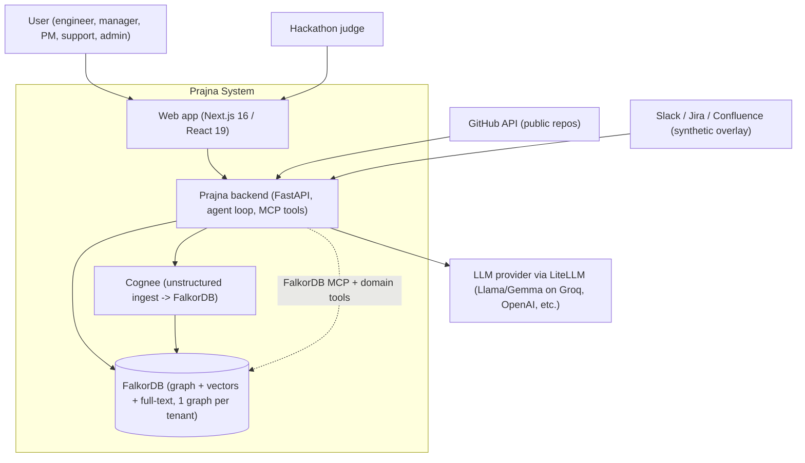
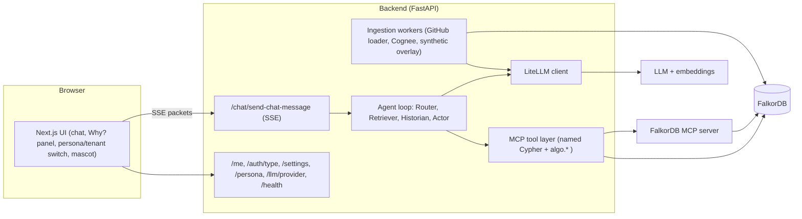
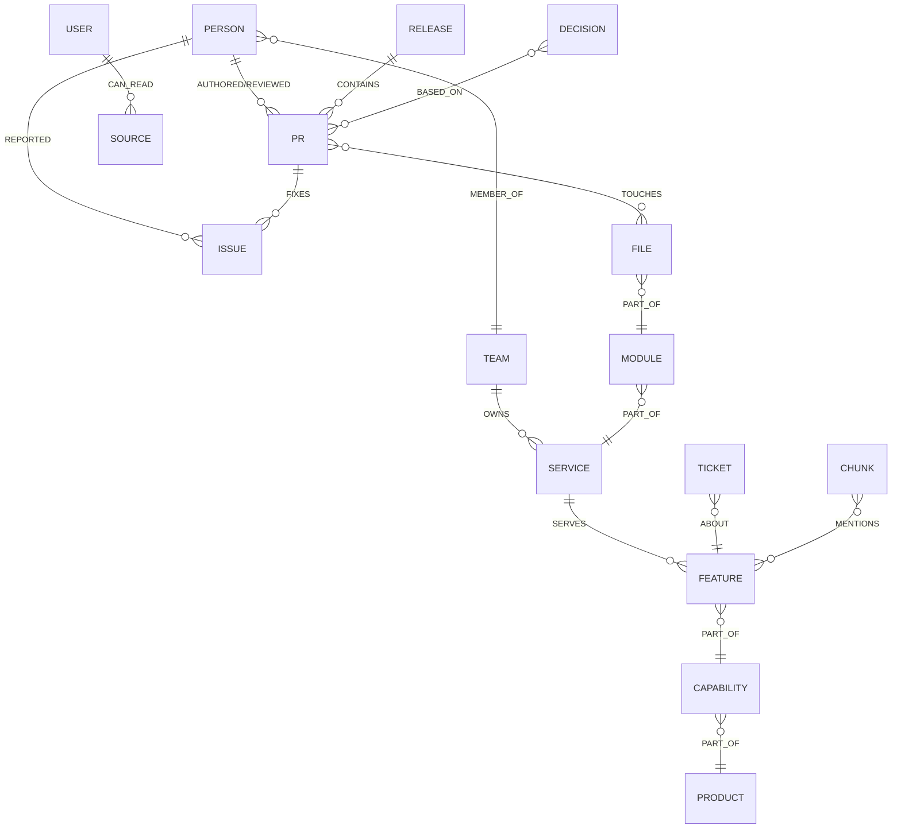
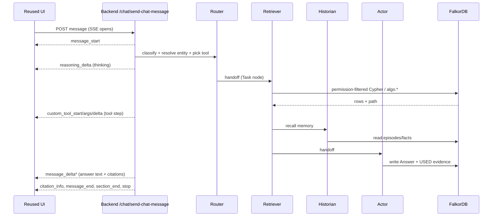
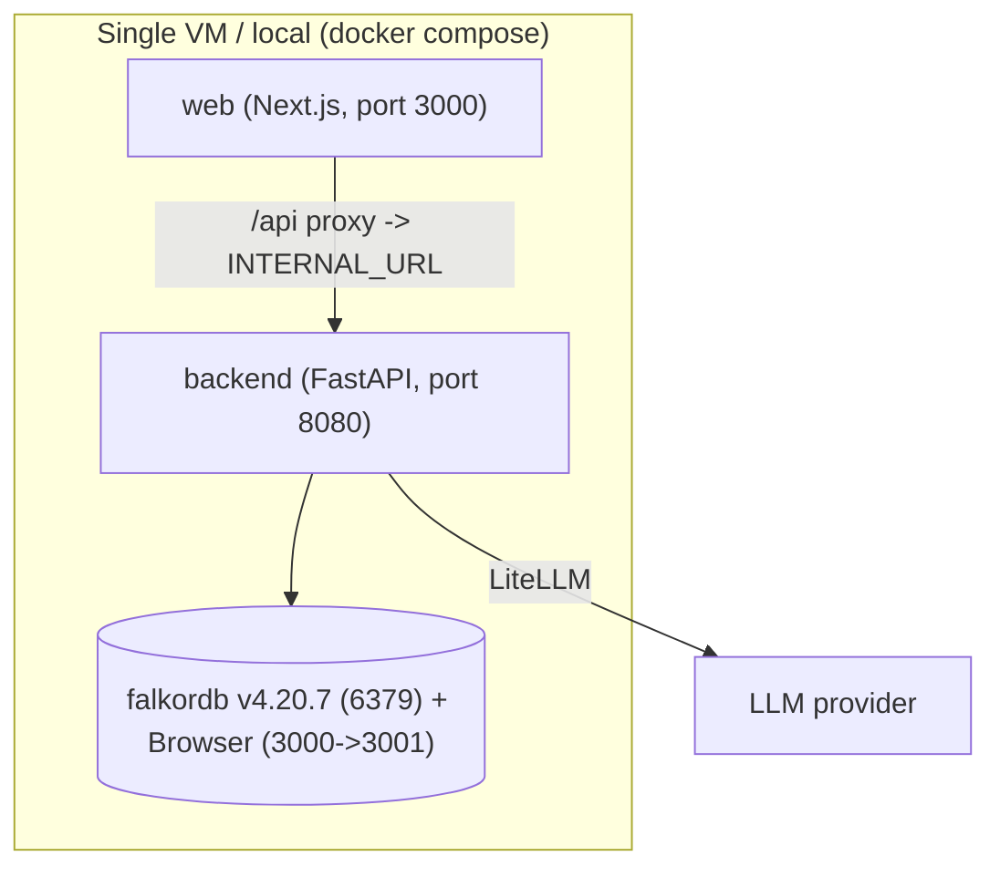

<!-- System architecture blueprint. Keep in sync with PRD.md and Specs.md. -->

# Prajna – System Architecture

**Last Updated**: 2026-10-18
**Status**: Complete
**Related Documents**: PRD.md, Specs.md, Rules.md

---

## 1. Architectural Goals & Principles
1. **Graph-first.** FalkorDB is the single source of truth and the reasoning engine. If FalkorDB is removed, the product does nothing useful (hackathon rule 3).
2. **Reasoning in Cypher, language in the LLM.** Rankings, paths, permissions, and memory are Cypher/`algo.*`; the LLM only classifies intent, picks tools, and writes prose.
3. **Permission-safe by construction.** Every retrieval starts from the user and traverses only `CAN_READ`-reachable nodes, filtered before any LLM call.
4. **Modern, responsive UI.** High-performance Next.js 16/React 19 web interface consuming real-time streaming agent steps.
5. **Explainable.** Every answer stores its Cypher and evidence path ("Why?").
6. **Multi-tenant and simple.** One FalkorDB instance holds one isolated graph per tenant; one `docker compose up` runs everything.
7. **Pragmatic over clever.** Plain Python agent loop before heavy frameworks; no second datastore.

## 2. High-Level System Overview

Prajna is a **modular monolith backend** (Python/FastAPI) in front of a single **FalkorDB** instance, serving a **modern Next.js frontend** (`web/`). Built from scratch during the hackathon sprint (15–18 Oct 2026), this architecture keeps the "FalkorDB is central" story obvious, latency minimal, and deployment seamless.

Data enters through two ingestion paths. **Structured ingestion** (GitHub issues/PRs/releases/authors and a synthetic org overlay) is written directly as parameterised Cypher `MERGE` statements. **Unstructured ingestion** (docs, discussions, markdown) flows through **Cognee**, configured with the FalkorDB hybrid adapter so that both the extracted entity graph and the vector chunks land inside FalkorDB — never a separate vector store. Identity stitching merges each person's GitHub/Slack/Jira identities into one `Person` node.

At query time, a **chat request** from the UI hits the backend's `send-chat-message` endpoint, which runs a small **multi-agent loop**: a Router resolves intent and entities and selects an MCP tool; a Retriever executes a permission-filtered Cypher/algorithm query; a Historian recalls memory; an Actor drafts any action and writes the `Answer` evidence node. Agents coordinate through `Task` nodes in FalkorDB. The backend streams the answer back as **SSE packets** (message, reasoning, custom-tool step, citations), so the frontend renders answers, real-time reasoning deltas, tool steps, and "Why?" paths smoothly.

LLM calls are routed through **LiteLLM** (small models for intent/tool-selection, a mid model for final prose, an embedding model for similarity). Tool execution uses the **FalkorDB MCP server** plus Prajna's own named-query MCP tools. Each tenant is a separate graph key in the one FalkorDB instance (multigraph tenancy).

## 3. System Context Diagram (C4 Level 1)


## 4. Container Diagram (C4 Level 2)


## 5. Component Breakdown (per container)
| Container | Component | Responsibility |
|---|---|---|
| Backend | Router agent | Classify intent, resolve entities, choose MCP tool |
| Backend | Retriever agent | Run permission-filtered Cypher + algorithms |
| Backend | Historian agent | Recall/write memory (personal/team/org, time-valid) |
| Backend | Actor agent | Draft notifications/issues, write `Answer` evidence |
| Backend | MCP tool layer | `who_knows`, `project_status`, `blast_radius`, `impact_ranking`, `decision_trace`, `bus_factor`, `search_chunks`, `claim_task` |
| Backend | Streaming adapter | Convert agent output to SSE packets |
| Backend | Ingestion | GitHub loader, Cognee pipeline, synthetic overlay, identity stitching |
| Backend | Auth shim | `auth_type: disabled` + persona switcher for demo |
| FalkorDB | Graph store | Nodes, edges, vector index, full-text index, per-tenant graphs |
| Web | Chat + Why? + switchers | Prajna Web UI (Next.js) |

## 6. Data Architecture

### 6.1 Storage choices
- **FalkorDB only.** Graph data, vector embeddings (vector index), and keyword search (full-text index) all live in FalkorDB. No Postgres/Qdrant/Vespa/Elasticsearch for answers, memory, or permissions.
- Cognee may keep minor operational metadata in its own small store, but **no answer may be derived from it**.

### 6.2 Core graph model (summary; full in GRAPH_MODEL/Specs)


### 6.3 Indexes
- Name/id indexes on `Person`, `Service`, `Feature`, `Issue`, `PR`.
- Full-text index on `Doc.text`, `Message.text`.
- Vector index on `Chunk.embedding` (cosine).
- Created via DDL (`CREATE FULLTEXT INDEX ...`, `CREATE VECTOR INDEX ...`) — compatible with 4.x and 6.x.

### 6.4 Multi-tenancy
Each tenant = one FalkorDB graph key (e.g., `tenant_kirana`, `tenant_globex`). The backend selects the graph per request. Cognee datasets are routed per tenant.

## 7. Request/Chat Flow (sequence)


## 8. Technology Stack
| Category | Choice | Notes |
|---|---|---|
| Graph DB (only DB) | FalkorDB (pinned `v4.20.7`; test 6.0 Day 1) | GraphBLAS, Redis protocol, vector + full-text, multigraph |
| Backend | Python 3.11–3.13, FastAPI, SSE | Cognee adapter needs 3.11–3.13 |
| Unstructured ingest | Cognee + `cognee-community-hybrid-adapter-falkor` | Writes graph + vectors into FalkorDB |
| Structured ingest | PyGithub + parameterised Cypher `MERGE` | Idempotent |
| Agent loop | Plain Python (optionally LangGraph with FalkorDB-backed state) | State in FalkorDB, not memory |
| Tools | FalkorDB MCP server + Prajna named-query tools | MCP tool selection (T1) |
| LLM routing | LiteLLM | Small for intent/tools, mid for prose, embeddings for similarity |
| Frontend | Prajna `web/` (Next.js 16, React 19) | Modern responsive UI, MIT |
| Deploy | Single VM or local compose | `docker compose up` |
| Graph viewing | FalkorDB Browser + small in-app path view | For "Why?" |

## 9. Deployment Architecture

- `INTERNAL_URL` in the web app points at the backend (default `http://localhost:8080` or `http://prajna-backend:8080`).
- In dev, the Next.js route `/api/[...path]` proxies to `INTERNAL_URL`; in production, nginx (or the same proxy with `OVERRIDE_API_PRODUCTION=true`) does it.
- Pin the FalkorDB image tag; persist a volume for the graph.

## 10. Cross-Cutting Concerns
- **Auth (demo):** `/auth/type` returns `disabled`; `/me` returns the active user persona; a UI switcher changes persona to demo permissions.
- **Permissions:** a single Cypher prefix helper (user → `CAN_READ` → sources) is reused by every tool; the leak test guards regressions.
- **Observability:** log the chosen tool, executed Cypher, and per-query latency; surface latency in the UI.
- **Config/secrets:** `.env` with `.env.example`; never logged.
- **Error handling:** if LLM/Cognee fail, return raw graph rows; never crash the stream.

## 11. Key Architectural Decisions (ADRs, brief)
| ID | Decision | Rationale | Alternatives rejected |
|---|---|---|---|
| ADR-1 | FalkorDB as the only datastore (graph+vector+FT) | Hackathon rule 3; simpler; honest "graph is central" | Postgres+Qdrant (makes graph optional) |
| ADR-2 | Modern Next.js + FastAPI decoupled architecture | Clean separation of concerns; backend executes native Cypher | Monolithic SSR (slower streaming) |
| ADR-3 | Structured SSE packet streaming contract | Streams reasoning deltas, tool steps, and citations in real time | Single opaque websocket |
| ADR-4 | Permission filter in Cypher, pre-LLM | Provable 0-leak; enterprise trust | Post-filter after retrieval (leak risk) |
| ADR-5 | Cognee only for unstructured ingest | Keeps our Cypher explainable; rule-safe | Let Cognee answer (hides FalkorDB) |
| ADR-6 | Pin FalkorDB v4.20.7 | Stable Cypher runtime & multi-graph support | Use :latest (unverified breaking changes) |
| ADR-7 | Plain Python agent loop | Debuggable and fast (<5ms); state in graph | Heavy agent frameworks (opaque, slow) |

## 12. Risks (architectural) & Mitigations
| Risk | Mitigation |
|---|---|
| Real-time streaming contract complexity | Implement structured packet generator Day 1; verify with `verify.py` |
| FalkorDB version/adapter breakage | Pin v4.20.7; DDL indexes; port 6379; Day-1 test |
| Permission filter missed somewhere | Single shared prefix helper; leak test in CI/`verify.py` |
| Second-store temptation | Rule in Rules.md; code review; removal test |
| LLM latency/cost at judging | Small models on Groq/OpenAI; cache ingestion; raw-rows fallback |

## 13. Folder Structure (target)
```
prajna/
  prajna/
    app/
      main.py                # FastAPI app, routes incl. send-chat-message (SSE)
      boot_routes.py         # /me, /auth/type, /settings, /persona, /llm/provider, /health
      agents/                # router.py, retriever.py, historian.py, actor.py
      tools/                 # mcp_tools.py + queries/*.cypher (named queries)
      ingest/                # github_loader.py, cognee_ingest.py, synthetic_overlay.py, identity.py
      graph/                 # falkor_client.py, schema.py (indexes), permissions.py
      memory/                # episodes.py, facts.py, sessions.py
      streaming/             # packets.py (Prajna SSE stream)
      llm/                   # litellm_client.py
      config.py              # env, tenant selection
    verify.py                # evaluation harness
    requirements.txt         # pinned
    Dockerfile
  web/                       # Prajna Next.js UI (React 19, Tailwind)
  vibe-coding/               # Project specification & living memory
  docker-compose.prajna.yml  # falkordb (pinned) + backend + web
  Makefile                   # build, up, down, verify
  .env.example
  README.md
```