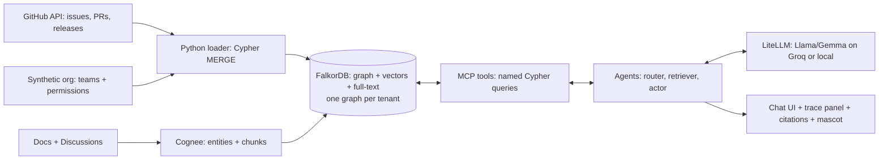

# Graph Hacks 2026 — Master Notes (everything in one place)

> Team: B0ts (previous entry: *Divya Drishti*, AI code review tool, WeMakeDevs × Cognee "The Hangover Part AI")
> Working project: **Prajna** — an open-source, graph-native "AI teammate" (DevRev Computer–style) on FalkorDB + Cognee
> Last updated: 18 Oct 2026
> Status legend: ✅ confirmed from official page/docs · ⚠️ verify again before relying on it · 💡 our own decision/assumption

---

## Table of contents

1. [Key dates and deadlines](#1-key-dates-and-deadlines)
2. [Event basics](#2-event-basics)
3. [The challenge brief](#3-the-challenge-brief)
4. [Tracks and key focus bullets](#4-tracks-and-key-focus-bullets)
5. [Prizes](#5-prizes)
6. [Official FAQ](#6-official-faq)
7. [All 18 rules (with what they mean for us)](#7-all-18-rules-with-what-they-mean-for-us)
8. [Submission checklist](#8-submission-checklist)
9. [The "FalkorDB is not decoration" rule — deep dive](#9-the-falkordb-is-not-decoration-rule--deep-dive)
10. [Official resources and links](#10-official-resources-and-links)
11. [FalkorDB technical facts and gotchas](#11-falkordb-technical-facts-and-gotchas)
12. [Cognee technical facts and gotchas](#12-cognee-technical-facts-and-gotchas)
13. [FalkorDB vs competitors](#13-falkordb-vs-competitors)
14. [Lessons from past hackathons](#14-lessons-from-past-hackathons)
15. [Idea evaluation history and final decision](#15-idea-evaluation-history-and-final-decision)
16. [Prajna — full project spec](#16-prajna--full-project-spec)
17. [AI / LLM strategy (cost and speed)](#17-ai--llm-strategy-cost-and-speed)
18. [Proof and verification plan](#18-proof-and-verification-plan)
19. [Demo video plan](#19-demo-video-plan)
20. [Build plan (pre-hackathon + day by day)](#20-build-plan-pre-hackathon--day-by-day)
21. [Name and mascot](#21-name-and-mascot)
22. [Market and business numbers (for one pitch slide)](#22-market-and-business-numbers-for-one-pitch-slide)
23. [Research papers (associated / not associated)](#23-research-papers-associated--not-associated)
24. [Existing open-source tools (and why we don't white-label them)](#24-existing-open-source-tools-and-why-we-dont-white-label-them)
25. [Risks and mitigations](#25-risks-and-mitigations)
26. [Judging self-check](#26-judging-self-check)
27. [Day-1 verification list (things to test first)](#27-day-1-verification-list-things-to-test-first)
28. [Quick reference commands and queries](#28-quick-reference-commands-and-queries)
29. [Source links](#29-source-links)

---

## 1. Key dates and deadlines

All times **IST (GMT+5:30)**.

| When | What | Notes |
|---|---|---|
| Now → 14 Oct | Pre-hackathon prep | **Only** ideas, notes, graph-model sketches, diagrams. **No code, no repo with code.** |
| **12 Oct** 💡 | Final idea lock | Stop switching ideas after this. |
| **15 Oct, 12:01 AM** ✅ | Hackathon starts | Coding may begin. Create the repo *after* this. |
| 15 Oct end of day 💡 | Checkpoint 1 | One demo scene works end to end (ugly is fine). |
| 16 Oct end of day 💡 | Checkpoint 2 / feature freeze | All demo scenes work. No new features after midnight. |
| 17 Oct 💡 | Proof + deploy + video | `verify.py`, deployment, README, demo video, blog post. |
| **18 Oct, ~8:00 PM** 💡 | Our own submit target | 4-hour buffer before the official close. |
| **18 Oct, 11:59 PM** ✅ | Submissions close | Hard deadline. |

Schedule page (kickoff, workshop, office hours): https://www.wemakedevs.org/hackathons/falkordb/schedule ⚠️ check exact session times.

---

## 2. Event basics

| Item | Detail |
|---|---|
| Name | **Graph Hacks: Context for AI Agents** ✅ |
| Powered by | **FalkorDB** ✅ |
| Organiser | **WeMakeDevs**, in collaboration with FalkorDB (independent developer hackathon) ✅ |
| Where | Online, from anywhere; open worldwide ✅ |
| Cost | Free to enter ✅ |
| Experience needed | No graph database experience needed ✅ |
| Team size | Solo or up to **4** people ✅ |
| Team membership | Each participant can be in **only one** team ✅ |
| Registration | Register once (solo or team) ✅ |
| Code of Conduct | WeMakeDevs Code of Conduct applies ✅ |
| Prize pool | **$20,000 total** ✅ |
| Community / help | FalkorDB Discord — fastest place for answers and to find teammates ✅ |
| Rule changes | Rules, schedule and prize breakdown may change before the start; announced in WeMakeDevs and FalkorDB community channels ✅ |
| Main pages | https://www.wemakedevs.org/hackathons/falkordb · rules: https://www.wemakedevs.org/hackathons/falkordb/rules |

---

## 3. The challenge brief

**Tagline:** Agents are only as good as the context they work with. Give yours a graph: connected data it can reason over, a memory it keeps between sessions, and a clear picture of how things relate. Build an agent that makes decisions you can trace.

**The challenge:** Build a working agent, or a group of agents, with FalkorDB as its context layer. **The graph has to shape what the agent does, not sit on the side.**

- **The problem:** Agents see pieces, not the whole picture. They lose track of earlier sessions, miss how people/systems/records relate, and can't explain why they made a choice.
- **The shift:** Put the agent's context in a graph — data, memory and company knowledge become nodes and edges the agent can follow.
- **The brief:** Build an agent that acts on connected data, remembers what it learns, and can show how it got to each answer.

**Work the graph has to do (5 items — use as a checklist):**
1. Follow connections across data
2. Remember across sessions
3. Share state between agents
4. Connect people, projects and decisions
5. Show the path behind an answer

**Other notes from the page:**
- "One agent problem": pick a task where the answer depends on how things connect.
- Example agent questions from the page: *Which accounts are linked to this flagged transaction? What did this customer ask for last month, and was it resolved? Who on the team has worked on this system before? What breaks if this service goes down?*
- Why graphs: a graph DB stores relationships directly, so the agent follows them in one query instead of stitching records together each step.

---

## 4. Tracks and key focus bullets

You can enter **one, two or all three**. Each track has its own prize. **You must name every track you enter when you submit.** Guide from the FAQ: acts on data → T1; remembers/coordinates → T2; works with company knowledge → T3.

### 🕵️ Track 01 — Agents That Act on Connected Data
Build an agent that uses the graph to decide and act (examples: investigate fraud, triage security findings, work through a codebase).
- Multi-hop reasoning
- Graph queries and algorithms as agent tools
- Tool selection through MCP
- Actions based on what the graph shows
- Explainable results

### 🤖 Track 02 — Agent Memory and Coordination
Agents that remember across sessions and share state. Memory should persist, update over time, and be available to every agent that needs it.
- Episodic, semantic and procedural memory
- Persistent conversation history
- Shared state and handoffs between agents
- High-concurrency reads and writes
- Separate memory per user or tenant

### 🧠 Track 03 — Company Brain
An agent that understands how a company works: people, teams, projects, documents, decisions in one graph.
- Knowledge from docs, tickets and chats in one graph
- Who owns what, and who knows what
- Tracing decisions back to their source
- Keeping knowledge current as things change
- Answers with clear sources

---

## 5. Prizes

| Prize | Item | Notes |
|---|---|---|
| Track 01 winner | **iPhone 18 Pro** ✅ | Every member of the winning team gets one |
| Track 02 winner | **PS5 with GTA VI** ✅ | Every member |
| Track 03 winner | **M6 Mac Mini** ✅ | Every member |
| Best blog post | **AirPods 5** ⚠️ | Seen on event page during research — verify |
| Top 50 | **T-shirts** ⚠️ | Seen during research — verify |

- Total pool: $20,000 ✅
- Intellectual property belongs to the participant/team. Agree ownership inside the team before submitting ✅.
- 💡 Write the blog post — it's a separate prize and also helps judges understand the project.

---

## 6. Official FAQ

| Question | Answer |
|---|---|
| Is FalkorDB mandatory? | **Yes.** It must be the primary graph DB and support a central part of the product. |
| More than one track? | Yes — one, two or all three. Each has its own prize. |
| Any language? | Yes — any language, framework, frontend, deployment platform. |
| Continue an existing project? | You may reuse general libraries, templates, infrastructure. **The submission and its main FalkorDB implementation must be new work completed during the event.** |
| Coding assistants? | Yes. You're responsible for code, architecture, security, correctness, and must be able to explain what was built and why. |
| Must it be deployed? | Live deployment **preferred**. If not deployable: complete local setup instructions + a working demo video. |

---

## 7. All 18 rules (with what they mean for us)

| # | Rule (summary) | What it means for us |
|---|---|---|
| 1 | Solo or team of up to 4; one team per person | 4 members, clear roles |
| 2 | FalkorDB must be the primary graph DB and support a central part of the product | FalkorDB is our **only** database |
| 3 | The graph must do real work; if the product still works with FalkorDB removed, it's decoration | See section 9 — removal test in the demo |
| 4 | Run FalkorDB any way (Docker, self-hosted, FalkorDB Cloud); any language/framework/frontend/platform | We self-host Docker on a VM, Cloud as option |
| 5 | Open-ended within the three tracks; enter any/all; **name every track** on submission | Name **Track 01, 02, 03** |
| 6 | Use only public, synthetic or your own data. **No** private, login-protected, paywalled, personal or restricted data | Public GitHub data + small synthetic org layer; never real personal/financial data |
| 7 | Runs 15 Oct 12:01 AM IST → 18 Oct 11:59 PM IST | Submit early |
| 8 | Main coding and design work begins after start; beforehand only ideas, notes, graph-model sketches, diagrams | **No code before 15 Oct** |
| 9 | Frameworks, OSS libraries, public APIs, templates, third-party tools, public datasets/assets allowed; original work during the hackathon is judged | Use Cognee, MCP server etc.; our own code is what counts |
| 10 | Every submission must include: public repo; README with setup **and graph data model**; the Cypher queries/graph algorithms used; demo video; live deployment or full local setup; the track(s) | See section 8 |
| 11 | AI coding assistants allowed but **must be disclosed** | `AI_USAGE.md` |
| 12 | Must understand the code and explain graph model, queries, architecture, technical decisions | Every member presents + explains ≥2 queries |
| 13 | Projects entirely AI-generated without meaningful contribution/verification/understanding may be rejected | Human-designed model and queries |
| 14 | $20,000 pool; best project per track wins (iPhone 18 Pro / PS5 + GTA VI / M6 Mac Mini); every team member gets the prize | — |
| 15 | IP belongs to the participant/team | Agree inside team |
| 16 | Treat everyone with respect | — |
| 17 | Harassment, discrimination, **plagiarism**, or manipulating judging → disqualification | **No white-labelling** of existing commercial products |
| 18 | Breaking these rules or the CoC may lead to disqualification | — |

⚠️ From another WeMakeDevs event's rules (not confirmed for this one): repos whose commit history doesn't match the event dates may be disqualified, and "if the video does not show it, it does not count." Treat both as true to be safe.

---

## 8. Submission checklist

| Item | Required? | Done |
|---|---|---|
| Public source-code repository | ✅ Required | ☐ |
| README: one-paragraph pitch | 💡 | ☐ |
| README: **tracks entered (01, 02, 03)** | ✅ Required | ☐ |
| README: setup instructions (`docker compose up`, `.env.example`, pinned versions) | ✅ Required | ☐ |
| README: **graph data model** (diagram + label/edge table) | ✅ Required | ☐ |
| README: **Cypher queries / graph algorithms** the product depends on (purpose, caller agent, file path) | ✅ Required | ☐ |
| README: architecture diagram | 💡 | ☐ |
| README: "Why FalkorDB is not decoration" section | 💡 | ☐ |
| README: data sources + licences + "synthetic layer" disclosure | 💡 | ☐ |
| README: verification results (`verify.py` output) + known limitations | 💡 | ☐ |
| README: team roles (who built/can explain what) | 💡 | ☐ |
| `AI_USAGE.md` (AI assistant disclosure) | ✅ Required (rule 11) | ☐ |
| Demo video showing the working project | ✅ Required | ☐ |
| Live deployment URL **or** complete local setup | ✅ Required | ☐ |
| Blog post (side prize) | 💡 | ☐ |
| Submitted before 18 Oct 11:59 PM IST (target 8 PM) | ✅ | ☐ |

---

## 9. The "FalkorDB is not decoration" rule — deep dive

**The test:** "If I stop the FalkorDB container, what still works?" → correct answer: **nothing useful.**
💡 Show this in the demo video: stop FalkorDB → the agent can't answer → start it → it works.

### What must live in FalkorDB

| Data / function | Lives in |
|---|---|
| Core entities (issues, PRs, docs, people, parts, releases) | FalkorDB |
| Text chunks + embeddings | **FalkorDB vector index** (no Qdrant/Pinecone/Chroma/Milvus) |
| Keyword search | **FalkorDB full-text index** (no Elasticsearch) |
| Agent memory (episodic, semantic, procedural) | FalkorDB |
| Agent handoffs / shared task state | FalkorDB (`:Task` nodes) |
| Chat sessions + history | FalkorDB (`:Session`, `:Message`) |
| Permissions (who can see what) | FalkorDB edges (`User→Team→CAN_READ→Source`) |
| Evidence behind every answer | FalkorDB (`:Answer`-[:USED]->…) |
| Rankings (expertise, risk) | FalkorDB algorithms (`algo.pageRank`, `algo.betweenness`, …) |

**Allowed outside FalkorDB:** the LLM (language only), GitHub API (source data loaded once), the UI (display only).

### Traps that quietly make FalkorDB secondary

| Trap | Fix |
|---|---|
| Cognee's default storage (its own local graph/vector DBs) | Configure the FalkorDB hybrid adapter for **both** graph and vector. Cognee may keep some metadata in a small relational DB — fine, but no answer may come from it. |
| Caching GitHub data in JSON/SQLite and reading that | Load into FalkorDB; all reads go to FalkorDB |
| Agent framework keeping state in memory (e.g. LangGraph's default checkpointer) | Write task state / handoffs to FalkorDB |
| Python loops doing ranking or path finding | Use Cypher + `algo.*` |
| Pretty graph view on top of a vector-search answer | The answer must come from the path shown |
| Second vector DB "for speed" | Use FalkorDB's vector index |

### Make it visible
1. README section "Why FalkorDB is not decoration": feature → Cypher query → what breaks without it.
2. "Why?" button on every answer shows the Cypher + returned path.
3. Removal test in the video.
4. One `docker-compose.yml` with FalkorDB as the only database.

**Contrast to use in the pitch:** Onyx (open-source enterprise search) runs on a search engine (Vespa/OpenSearch) + Postgres; its "knowledge graph" is optional, **off by default**, and stored as tables in Postgres. That design would *fail* this rule. Ours is graph-first.

---

## 10. Official resources and links

| Resource | Purpose |
|---|---|
| Getting started with FalkorDB | First page to open |
| Official documentation — https://docs.falkordb.com | Everything |
| FalkorDB on GitHub — https://github.com/FalkorDB/FalkorDB | Source, issues |
| GraphRAG SDK on GitHub | GraphRAG on FalkorDB |
| Run FalkorDB with Docker / Docker Compose | Setup |
| FalkorDB Cloud | No local setup |
| FalkorDB Browser | Create, query, explore visually (port 3000 in Docker) |
| Cypher query language reference — https://docs.falkordb.com/cypher/ | Query syntax |
| Client libraries | Python, Node.js, Java, Rust, Go, PHP, C# |
| Graph algorithms docs — https://docs.falkordb.com/cypher/procedures.html | `algo.*` |
| Integrations | GraphRAG-SDK, QueryWeaver, MCP, Graphiti, Cognee, LangChain, LlamaIndex |
| Examples / community projects | Inspiration |
| Videos | Write effective Cypher queries; Advanced graph algorithms; Graph and RAG talks; FalkorDB Cloud setup playlist |
| FalkorDB Discord | Help + teammates (ask about 6.0 vs 4.x on Day 1) |
| Cognee × FalkorDB docs — https://docs.falkordb.com/agentic-memory/cognee | Integration guide |
| FalkorDB MCP server — https://github.com/FalkorDB/FalkorDB-MCPServer | MCP tools |

Event-page sample query (who knows about a system):
```cypher
MATCH (p:Person)-[:WORKED_ON]->(:Project)-[:USES]->(s:System {name: $system})
RETURN p.name AS person, count(*) AS projects
ORDER BY projects DESC
LIMIT 5
```

---

## 11. FalkorDB technical facts and gotchas

### Facts
- Open-source graph DB built for AI agents; successor to RedisGraph (RedisGraph EOL Jan 2025).
- Architecture: sparse adjacency matrices + GraphBLAS (linear algebra); Redis protocol; **Rust engine since 6.0**.
- Query language: OpenCypher subset + extensions.
- **Multigraph / multi-tenancy:** one instance holds thousands of isolated graphs (vendor claims 10K+); each user/agent/tenant can get its own graph without separate deployments.
- Native **vector index** + **full-text index**.
- Algorithms (`algo.*`): PageRank, BFS, shortest paths (`algo.SPpaths`, `algo.SSpaths`), WCC (connected components), betweenness centrality, CDLP / label propagation (community detection), MSF, harmonic centrality.
- **Not available in 6.0 / any release (per FalkorDB's own issues): Leiden, Louvain, A\*, CCH.** Don't plan on them.
- Licence: **SSPLv1** (source-available, not OSI). Fine for a hackathon prototype.
- Docker: `docker pull falkordb/falkordb:latest` (see version warning below). Browser on port 3000, DB on 6379.

### Version warning (important)
- **FalkorDB 6.0 released 29 Sep 2026** and broke some integrations.
- Graphiti issue #1947 (open): 6.0 rejects the old multi-argument `db.idx.fulltext.createNodeIndex(...)` call.
- One project reported 6.0 boot-looping on an existing 4.x data volume.
- 💡 **Pin `falkordb/falkordb:v4.20.7`** unless a Day-1 test shows our exact stack (incl. Cognee adapter) works on 6.0.
- Use **DDL index syntax** (works on 4.x and 6.x):
  ```cypher
  CREATE INDEX FOR (s:Service) ON (s.name)
  CREATE FULLTEXT INDEX FOR (d:Doc) ON (d.text)
  CREATE VECTOR INDEX FOR (c:Chunk) ON (c.embedding) OPTIONS {dimension:1536, similarityFunction:'cosine'}
  ```

### Cypher limitations to avoid on camera
- Unreferenced relationships in a pattern are only checked for existence → counts can be wrong.
- `LIMIT` doesn't stop eager write operations.
- Indexes don't serve `<>` filters.
- No label expressions.
- No parameters in `LIMIT` / `SKIP`.
- Throughput plateaus after ~8 threads (single-threaded Redis core).

### FalkorDB Cloud free tier
- ~100 MB RAM, no TLS, no backups, no HA; reportedly sleeps on inactivity. Wake it before judging or self-host.

### FalkorDB strengths to show judges
1. Algorithms as agent tools that change what the agent does.
2. Multigraph tenancy (`GRAPH.LIST` on camera; isolated tenant graphs).
3. Per-step query latency in the UI (e.g., "path: 3 ms").
4. Graph + vector in one store (hybrid query).
5. MCP (official server + our domain tools).
6. FalkorDB Browser to show decision paths.
7. Cognee writing into FalkorDB.

---

## 12. Cognee technical facts and gotchas

| Item | Detail |
|---|---|
| What it is | Open-source AI memory: ECL pipeline (Extract → Cognify → Load) builds graph + vectors from text |
| Core calls | `add` → `cognify` (batch adds, then one cognify); `memify` for post-processing (v1.6.0 added opt-in `consolidate_entities`, cosine 0.85 default) |
| Memory API | remember / recall / improve / forget (1.x line) |
| Latest seen | v1.6.1 (24 Sep 2026) ⚠️ |
| Search types | `GRAPH_COMPLETION`, `CHUNKS`, `RAG_COMPLETION`, `SUMMARIES`, `TEMPORAL`, `CYPHER`, `NATURAL_LANGUAGE`, `GRAPH_COMPLETION_COT`, `HYBRID_COMPLETION` |
| Ontologies | Optional schema to guide extraction — pass our label list so extracted entities match our model |
| LLM routing | Uses **LiteLLM** — any provider |
| FalkorDB adapter | `pip install "cognee>=1.2,<2.0" cognee-community-hybrid-adapter-falkor` (adapter 0.4.0, 13 Aug 2026) |
| Adapter rules | Import its `register` **before** config; provider name is **`"falkor"`** (not `"falkordb"`); Python **3.11–3.13** |
| Multi-user / per-dataset graphs | `ENABLE_BACKEND_ACCESS_CONTROL=True` (default), `GRAPH_DATASET_DATABASE_HANDLER=falkor_graph_local`, `VECTOR_DATASET_DATABASE_HANDLER=falkor_vector_local` |
| MCP | `cognee-mcp` exists — optional; prefer our own MCP tools so judges see Cypher |

### Known issues
| Issue | Workaround |
|---|---|
| #2107: custom port not passed → `prune_system()` fails (`unknown command 'GRAPH.LIST'`) | Run FalkorDB on **6379**, or skip prune |
| Adapter compatibility with FalkorDB 6.0 unconfirmed | Pin v4.20.7; test on Day 1 |
| Community adapter maintenance is slow (a third-party author says no functional commit since 24 Jun 2026) | Keep Cognee at the edges (ingestion only) |
| Cognee and adapter versions must be upgraded together | Pin exact versions in `requirements.txt` on Day 1 |

### How we use Cognee (rule-safe pattern)
- **Use for:** turning docs/discussions/issue text into entities + chunks inside FalkorDB.
- **Don't use for:** agent decisions. Every decision = our named Cypher query via MCP.
- README documents every query and which agent calls it.

---

## 13. FalkorDB vs competitors

| DB | Architecture | Query language | Multi-tenancy | Licence | Notes |
|---|---|---|---|---|---|
| **FalkorDB** | In-memory, sparse matrices + GraphBLAS, Redis protocol | OpenCypher subset | Native multigraph | SSPLv1 | Fast traversals; built for agents |
| Neo4j | JVM, index-free adjacency | Cypher (most complete) | Mainly Enterprise | GPLv3 community / commercial | Most mature; big GDS library |
| Memgraph | In-memory C++ | Cypher | Enterprise | BSL 1.1 | Fast; MAGE algorithms |
| Kuzu | Embedded columnar | Cypher | — | MIT, **archived Oct 2025** | Don't build on it |
| NebulaGraph | Distributed | nGQL | Spaces | Apache-2.0 | Heavy ops |
| ArangoDB | Multi-model | AQL | Databases | BSL 1.1 | Not Cypher |
| Amazon Neptune | Managed AWS | openCypher/Gremlin/SPARQL | Per cluster | Proprietary | No local Docker |
| TigerGraph | Distributed MPP | GSQL | Graphs | Proprietary | Steep learning curve |

⚠️ Non-FalkorDB rows are general knowledge — double-check before quoting on stage.

### Benchmarks (be careful)
| Source | Claim | Credibility |
|---|---|---|
| FalkorDB blog (Dec 2024) | p50 55 ms vs 577.5 ms; p99 136.2 ms vs 46,923.8 ms (vs Neo4j) | Vendor-run; inconsistent with homepage "496x" (83 ms vs 41,157 ms) |
| FalkorDB KG blog | PageRank 18.53 ms vs 417.31 ms; WCC 17.8 ms vs 1,324.32 ms; 100 MB vs 600 MB memory | Vendor-run |
| **AIMultiple (Apr 2026, independent)** | Fastest on 11/12 queries; 6,693 vs 1,010 QPS; cold start 1.1 ms vs 90 ms; plateaus after 8 threads | Best independent evidence |
| Dev.to GraphRAG comparison (FalkorDB-affiliated author) | FalkorDB pipeline more accurate (97% vs 90% source recall) but Neo4j 27% faster end to end | SDK pipelines, not engines |

💡 On stage: say "independent benchmarks show FalkorDB is faster on most graph queries" — don't quote the 496x number.

---

## 14. Lessons from past hackathons

### WeMakeDevs × Cognee — "The Hangover Part AI: Where's My Context?" (we took part as B0ts / Divya Drishti)
Archive: https://archive.wemakedevs.org/hackathons/cognee/projects/top

| Project | Result | One-line problem | Why it worked / didn't |
|---|---|---|---|
| **Lethe** — https://github.com/vinayaksonthalia/lethe | 🏆 Winner (Track 1) | On-call assistant tells you to fix a server decommissioned last month | One sharp thesis (memory must **forget**); benchmarked vs plain RAG; honestly admitted 3 of 4 capabilities tied and built the product on the one real win; same question → different answer after forgetting |
| **ClassroomMemory** — https://github.com/RajdeepKushwaha5/ClassroomMemory | 🥈 Winner (Track 2) | Learning apps remember content, not students | Instantly relatable; visible graph logic ("teach functions before recursion"); shipped a verification script |
| **MemOps** (WarRoom) — https://github.com/priyansh-narang2308/memops-cognee-hackathon | Highlight, **not** winner | SRE incident correlation, "institutional amnesia" | Abstract problem; buzzword-heavy (3D WebGL war room, RDF, 10 search modes) |
| **Smriti** | Highlight, not winner | Incident memory for DevOps | Same crowded incident space |
| **Rewind** | #1 highlight | — | Used the sponsor's own repo (Cognee issues/PRs) as data — great trick |
| **CogneeVerdict** | Highlight | Legal | Legal space already seen |

**Pattern for winning:**
1. One-sentence problem everyone feels.
2. One visible before/after moment.
3. One measured proof vs a fair baseline (and honesty when it ties).
4. A verification script judges can rerun.
5. Cut buzzwords and fancy visuals that need explaining.

**Incident/WarRoom space is saturated in this judging community** (Lethe, MemOps, Smriti) → we dropped WarRoom.

### Neo4j hackathons (proxy for graph judging)
- Neo4j Aura Agent Hackathon 2026: ~40 submissions; each judged by multiple judges on a **100-point scorecard: Graph Matters · Useful Agent · Shows Thinking · Interesting Idea · Presentation**. Finalists were domain-grounded risk/triage agents (RegulatoryRisk GraphAgent 2nd; Korca Triage Agent, DepGraph Agent, DrugPath finalists).
- Neo4j "Hack the Video Agent Context Graph" (30 Jul 2026, SF): 151 builders, 37 projects; winner and 2 of top 3 built on the provided starter repo → working end-to-end beats novelty.
- ⚠️ No official scoring rubric was found for Graph Hacks — use the track bullets + the Neo4j scorecard as proxies.

### Competitor entries already public for Graph Hacks
- "Minutes" (shared, time-aware memory from meetings/email, Tracks 2 + 3).
- A solo Track-2 plan choosing "one track, done well".
→ Time-aware chat memory will be crowded. Our edge: graph-only questions + permissions + action.

---

## 15. Idea evaluation history and final decision

| # | Idea | Verdict | Reason |
|---|---|---|---|
| 1 | **WarRoom** (CVE/incident blast radius, synthetic company) | ❌ Dropped | Incident space saturated (Lethe won it; MemOps, Smriti); synthetic data felt fake |
| 2 | **Strix** white-label (open-source AI pentest agents, Apache-2.0) | ❌ Not allowed | Rebranding = plagiarism (rule 17); no FalkorDB inside; fails removal test. *Allowed alternative:* use Strix unmodified as an upstream scanner and build our own graph triage on its reports (disclosed). |
| 3 | FirstPR (open-source contribution navigator) | Backup | Real GitHub data, backtestable; developer-only audience |
| 4 | UPI/card dispute resolver ("Paisa Kahan Gaya?") | Backup | Very relatable (RBI TAT rule: UPI reversal T+1, ₹100/day compensation; card T+5) but data synthetic |
| 5 | Police "Jarvis" | ❌ | Profiling/bias ethics; classic Neo4j POLE demo; synthetic only. Safe reframe = evidence linking (IMEI, modus operandi) |
| 6 | Judge help bot | ❌ | High stakes, unverifiable in 4 days; legal already seen. Safe reframe = precedent checker (overruled?) |
| 7 | Supply chain management | ❌ for us | Fits tracks technically, but no domain knowledge on team; can't answer judges (rule 12); synthetic data |
| 8 | Supply-chain WarRoom on real data (repo deps + OSV CVEs, "one upgrade removes most risk", bus factor) | Backup | Real data, judges paste own repo; dev audience |
| 9 | Setu (customer complaints → code → fix shipped) | Absorbed into Prajna | Real GitHub data; duplicate labels = ground truth |
| 10 | Beyond the Diff (graph-aware PR review; reverts = ground truth) | Strong backup | Our domain (Divya Drishti); real data |
| 11 | **Prajna — open-source graph-native "Computer"** | ✅ **Current pick** | Copies Computer's distinctive features on a graph; real data; permissions as graph edges is provable and rare |

### Principle we agreed on ("beyond search")
> If a search tool (Onyx, Microsoft Copilot) could answer the question by retrieving **one document** → drop the feature.
> If it needs **connecting 3+ things or computing something** → that's our graph feature.

| Question | Search tool | Needs graph |
|---|---|---|
| "What does the policy say?" | ✅ | ❌ |
| "Status of issue #812?" | ✅ | ❌ |
| "Which 12 complaints are the same bug, and did the fix ship?" | ❌ | ✅ |
| "If I change this, what breaks and who must review?" | ❌ | ✅ |
| "Who knows this code now the author left?" | ❌ | ✅ |
| "Same question, intern vs security lead — what can each see?" | ⚠️ (filters, no path) | ✅ |

---

## 16. Prajna — full project spec

### One-line pitch
> "Computer by DevRev showed that AI teammates need a knowledge graph. We built an open-source one on FalkorDB: it answers with a traceable path, knows which 'Browser' you mean, and never shows you what you're not allowed to see."

### What DevRev Computer does (decoded)
- **Core idea:** connect identity, parts and work.
- **Dev / Rev:** Dev = provider (our team); Rev = customer.
- **Rev parts:** product → capability → feature (customer view). **Dev parts:** code / service / component.
- **Work:** conversation → ticket (customer) → issue (builders) → task.
- **Airdrop / AirSync:** ingestion + sync (third-party profiles say Airdrop is patented; we couldn't find the patent text — the *idea* of a support↔engineering graph is widely used). 💡 Use our own implementation and names; not legal advice.
- **Computer (2025 rebrand):** AI teammate; May 2026 added personal/team/org memory + Agent Studio.
- DevRev claims its memory layer scored 94.3% vs 63.6% for fetch-based retrieval with ~4.4x fewer tokens (their own benchmark).
- Company: founded 2020 by Nutanix founder Dheeraj Pandey; $100.8M Series A (Aug 2024) at ~$1.15B valuation.
- From the podcast (our notes): unified structured + unstructured data; conversational interface; context-aware reasoning (role, customers, projects); proactive search/summaries; **clickable citations**; **thinking trace**; **NER** (feature "Today's Message" vs the phrase); **permission honouring via IAM**; granular source selection; connector marketplace.

### What we copy vs skip
| Computer feature | Our version | Shown as | Track |
|---|---|---|---|
| Unified structured + unstructured | GitHub issues/PRs/releases + docs/discussions in one graph | Status question pulls from both | T3 |
| Thinking trace + clickable citations | Trace = the graph path; every node a link | "Why?" panel | T1 |
| Entity recognition | Mentions resolved to `:Feature`/`:Part` nodes ("Browser" = FalkorDB Browser) | Ambiguous question answered right | T1, T3 |
| Permission-aware answers | Permissions as edges; retrieval only walks allowed paths, before the LLM | Same question, two users, two answers | T2 |
| Actions | Draft replies to all users affected by a fixed issue; draft issues | One click → drafts | T1 |
| Memory across sessions | `:Session`, `:Fact`, `:Episode` | "Continue yesterday's investigation" | T2 |
| Connector marketplace, voice, desktop app, SSO | **Skip** | — | — |

### Data
| Layer | Source | Real / synthetic |
|---|---|---|
| Issues, PRs, releases, reviews | FalkorDB GitHub org (public) | Real |
| Docs + Discussions | FalkorDB docs + GitHub Discussions | Real |
| Parts hierarchy | Derived from docs + repo folders (LLM proposes, we confirm once) | Real-derived |
| Teams, roles, permissions, 2–3 private docs (e.g., security advisory draft) | We create | **Synthetic — disclose** |

Data rules: only public handles; no personal/private data; no real card/account data ever.

### Architecture


### Tool choices
| Need | Use | Avoid |
|---|---|---|
| Graph, vectors, full-text | FalkorDB | Qdrant, Milvus, Pinecone, Elasticsearch |
| Text → entities | Cognee | Writing our own extractor |
| Structured ingest | PyGithub + Cypher MERGE | Airbyte/Meltano (setup cost) |
| Agent tools | FalkorDB MCP server + our named queries | LLM writing raw Cypher on stage |
| Agent loop | Plain Python loop or LangGraph (state in FalkorDB) | CrewAI/AutoGen (debugging cost) |
| Permissions | Graph edges + filter in every query | Keycloak/Casbin (overkill) |
| LLM | LiteLLM + fast open model on Groq | Single-provider lock-in |
| UI | Chainlit (built-in step traces) or Next.js | Chat UI from scratch |
| Graph view | FalkorDB Browser + small path view | 3D WebGL graph |

### Graph model (minimum)
```
(:User)-[:MEMBER_OF]->(:Team)-[:CAN_READ]->(:Source)
(:Doc|:Issue|:PR|:Discussion)-[:FROM]->(:Source)
(:Issue)-[:ABOUT]->(:Feature)-[:PART_OF]->(:Capability)-[:PART_OF]->(:Product)
(:Feature)-[:SERVED_BY]->(:Module)
(:PR)-[:FIXES]->(:Issue)     (:Release)-[:CONTAINS]->(:PR)
(:Issue)-[:DUPLICATE_OF]->(:Issue)
(:Person)-[:AUTHORED|REVIEWED]->(:PR)     (:Person)-[:REPORTED]->(:Issue)
(:Chunk)-[:MENTIONS]->(:Feature)                 // from Cognee
(:Session)-[:ASKED]->(:Question)-[:ANSWERED_WITH]->(evidence)
(:Agent)-[:CLAIMED]->(:Task)   (:Agent)-[:HANDED_OFF {at,note}]->(:Agent)
(:Fact {text, valid_from, valid_to})-[:ABOUT]->(any)
```

### Agents
| Agent | Job |
|---|---|
| Router | Understands the question, resolves entities, picks MCP tools |
| Retriever / Investigator | Runs permission-filtered multi-hop queries + algorithms |
| Historian | Recalls sessions, facts, past episodes |
| Actor / Scribe | Drafts replies/issues, writes `:Answer` evidence path |
All handoffs via `:Task` nodes in FalkorDB.

---

## 17. AI / LLM strategy (cost and speed)

**Rule of thumb:** LLM for language, Cypher for reasoning.

| Step | AI? | Tier |
|---|---|---|
| Understand question / intent | Yes | Small, fast |
| Pick tool (MCP) | Yes | Small/mid |
| Paths, owners, rankings, permissions | **No** — Cypher + `algo.*` | — |
| Entity extraction from docs | Yes (Cognee, at ingest) | Small/mid |
| Similarity | Embeddings + graph expansion | Embedding model |
| Final answer / drafts | Yes | Mid |
| Memory writes, handoffs | **No** — Cypher | — |

| Tier | Example models | Where | Use |
|---|---|---|---|
| Fast/cheap | Llama 3.x 8B, small Gemma | Groq / Cerebras / local Ollama | Intent, routing, extraction |
| Mid | Llama 3.x 70B class or hosted mid model | Groq / Together / OpenRouter | Answers, drafts |
| Embeddings | Small open embedding model | Local or hosted | Similarity |

- Route everything through **LiteLLM** (Cognee already uses it) → "cost mode vs quality mode" switch.
- Rough cost: a full run ≈ 10–15 calls, mostly small models → a few cents or less ⚠️ check current price pages.
- Ingestion is the expensive part → run Cognee once on a curated doc set and cache.

---

## 18. Proof and verification plan

Ship as `verify.py` with results saved as JSON in the repo, so judges can rerun everything.

| Test | Method | Target / report |
|---|---|---|
| **Permission leaks** | N questions × each role; assert zero unauthorized nodes in retrieved evidence or citations | **0 leaks** (deterministic) |
| Grounding | Every claim cites a node that exists in the graph | % answers fully cited |
| Graph vs vector-only | 30 hand-written questions with known answers from GitHub; compare our graph agent vs plain vector RAG on the same text | Both scores, reported honestly (even if the gap is small) |
| Entity resolution | 15 ambiguous questions ("Browser", etc.) | % resolved to the correct Part |
| Duplicate detection (optional) | Hide GitHub "Duplicate of #…" labels, let the agent find duplicates | Hit@3 vs vector-only |
| Concurrency (T2) | Parallel agents claiming tasks with version check | 0 double-claims, timing numbers |

💡 Lethe's lesson: if the graph doesn't clearly win on something, find the one thing it does win and build the story around it. Never invent numbers.

---

## 19. Demo video plan

Target **2–3 minutes**. Show every claimed feature (if the video doesn't show it, assume it doesn't count).

| Time | Scene | Feeling |
|---|---|---|
| 0:00–0:15 | Hook: "Computer by DevRev proved AI needs a knowledge graph. Here's an open-source one, running on FalkorDB's own repo." | Instantly placed |
| 0:15–0:45 | "What's the status of vector index bugs, and who's working on them?" → answer + trace path + clickable GitHub links | "It shows its work" |
| 0:45–1:05 | "Any open issues with Browser?" → resolves to FalkorDB Browser (the product) | "It understands our words" |
| 1:05–1:30 | Same question: intern vs security lead → advisory only for the lead; **mascot closes its eye** for the intern; leak test "100 queries, 0 leaks" | "Enterprise-ready" |
| 1:30–1:50 | "Draft a reply to everyone affected by #812 — fix shipped" → drafts with release link; new session: "continue yesterday's investigation" | "It acts and remembers" |
| 1:50–2:10 | Removal test: stop FalkorDB → nothing works; architecture slide; proof chart | "Graph is the product" |
| 2:10–2:30 | README queries, AI disclosure, team | Rules covered |

Tips: show query text + latency on screen; small believable story; no feature that needs explaining.

---

## 20. Build plan (pre-hackathon + day by day)

### Roles (team of 4)
| Person | Owns |
|---|---|
| P1 — Graph & data | Graph model, GitHub loader, parts hierarchy, synthetic org + permissions, Cypher, algorithms, `verify.py` |
| P2 — Agents & MCP | Agent loop, MCP tools, routing, actions, handoffs |
| P3 — Memory & Cognee | Cognee ingest into FalkorDB, vector index, sessions/facts/episodes, tenants |
| P4 — Product | UI, trace panel, mascot, deployment, README, video, blog |

### Pre-hackathon (until 14 Oct) — notes and diagrams ONLY
| Task | Owner |
|---|---|
| Lock idea and pitch (by 12 Oct) | All |
| Draw graph model + agent sequence diagrams (Excalidraw) | P1, P2 |
| Write the 4 demo questions + 30 test questions with expected answers (from GitHub by hand) | P1, P3 |
| Read FalkorDB Cypher limits, `algo.*` docs, Cognee docs | All |
| Check names/domains (Prajna) | P4 |
| Write demo script + "why not decoration" argument | P4 |
| Join FalkorDB Discord, attend kickoff | All |
| **Do NOT:** write code, create repo with code, pre-build loaders | — |

### Day by day
| Day | P1 | P2 | P3 | P4 | Checkpoint |
|---|---|---|---|---|---|
| **Day 1 (15 Oct)** | Repo init; FalkorDB pinned v4.20.7; indexes; GitHub loader; synthetic org | Agent loop + 3 MCP tools (search, status, who-owns) | Cognee + adapter install; ingest docs; **test 6.0 compatibility**; pin versions | UI shell; trace panel; pick deploy target | Scene 2 works end to end |
| **Day 2 (16 Oct)** | Permission filter in every query; entity-resolution query | Action tool (draft replies); router | Session/Fact memory; "continue yesterday" | Clickable citations; path view; mascot states | All scenes work; **freeze at midnight** |
| **Day 3 (17 Oct)** | `verify.py` + results JSON | Bug fixes only | README: model, queries, AI disclosure | Deploy; record video; blog | Live URL, video draft |
| **Day 4 (18 Oct)** | Buffer | Buffer | Buffer | Final polish | **Submit by ~8 PM IST** |

---

## 21. Name and mascot

### Name options
| Name | Meaning | Note |
|---|---|---|
| **Prajna** ⭐ (chosen) | Sanskrit *prajñā*: wisdom, deep insight — knowing that comes from seeing how things connect | Short, easy to say worldwide, fits "graph that understands your company". Check domain/GitHub/trademark (name is used by some other products) |
| Sutra | Thread / formula that ties things | ⚠️ TWO AI's SUTRA LLMs exist |
| Setu | Bridge | ⚠️ Indian fintech named Setu exists |
| Indrajaal | Indra's net — every jewel reflects all others (= knowledge graph) | Also means "illusion/magic" |
| Chitta | Mind's store of memories | Less known |
| Saarthi | Charioteer/guide | Very common |
| Trinetra | Third eye | Used by government projects |

Pitch line: *"Prajna means wisdom — not just knowing facts, but seeing how they connect. Our agent sees your whole company graph and tells you why."*

### Mascot
- **Original design:** a standalone graph node with an eye; pupil = tiny constellation of nodes; threads to satellite nodes.
- **Do NOT** copy DevRev's eye-inside-a-letter idea.
- **Avoid an owl** (*ullu* = "fool" slang in Hindi).
- Colours: teal = seeing/answering; saffron = closed/restricted.
- States: Idle (blink, look around) → Thinking (eye hops node to node, threads light) → Answer (path stays lit) → **Restricted (eye closes)**.
- Use in only 3 places: chat avatar, loading state, restricted moment.
- Build as plain SVG + CSS animation. Max half a day on branding.

---

## 22. Market and business numbers (for one pitch slide)

| Fact | Number |
|---|---|
| New CVEs in 2025 | 48,185 (+20.6% vs 39,962 in 2024), ~131/day |
| CVEs fully analysed by NVD | ~28% |
| Major incident cost | Can exceed $1M per hour |
| PagerDuty FY2026 revenue | $492.5M (+5.4%); 15,351 paid customers; launched an AI SRE agent |
| Security & vulnerability management market | $17.55B (2025) → $24.07B (2030), 6.5% CAGR |
| Exposure management | $7.6B by 2029, 28.3% CAGR |
| DevRev | ~$1.15B valuation (Aug 2024) |
| "Incident response market" estimates | Disagree 4x ($19.64B vs $84.8B by 2030) — **don't quote** |

### SaaS model (💡 our assumptions)
| Plan | Price | For |
|---|---|---|
| Free | $0 | OSS projects, students |
| Team | ~$300/month | 10–50 engineers |
| Business | ~$1,500/month | 50–500 engineers |
| Enterprise | $50K+/year | Self-hosted, SSO, compliance |

| Scenario | Customers | ARR |
|---|---|---|
| Year 1 | 30 Team + 5 Business | ~$198K |
| Year 2 | 150 Team + 30 Business + 2 Enterprise | ~$1.18M |
| Year 3 | 500 Team + 120 Business + 10 Enterprise | ~$4.5M |

Honest view: crowded market (DevRev, Onyx, Microsoft, Glean). Edge = graph-native, open-source, cheaper for small/mid teams and price-sensitive markets. **Judges score the graph work, not the business plan — one slide max.**

---

## 23. Research papers (associated / not associated)

⚠️ Several arXiv IDs are from general knowledge — verify before citing in README/blog.

| Paper (year) | Link | Key idea | Use for us | Association |
|---|---|---|---|---|
| Zep: Temporal KG Architecture for Agent Memory (2025) | arxiv.org/abs/2501.13956 | Bi-temporal edges; episodic + semantic subgraphs | `Fact.valid_from/valid_to` | **Direct** (T2, T3) |
| Optimizing the Interface Between KGs and LLMs (Cognee, 2025) | arxiv.org/abs/2505.24478 | Cognee ECL pipeline tuning | Justify Cognee config | **Direct** (note small holdout sets) |
| G-Memory: Hierarchical Memory for Multi-Agent Systems (2025) | arxiv.org/abs/2506.07398 | Insight/query/interaction graph for MAS | Shared multi-agent memory | **Direct** (T2) |
| From Local to Global: GraphRAG (Microsoft, 2024) | arxiv.org/abs/2404.16130 | Entity graph + community summaries | Global questions | Associated |
| HippoRAG (2024) | arxiv.org/abs/2405.14831 | KG + Personalized PageRank retrieval | PageRank as retrieval tool | **Direct** (T1) |
| LightRAG (2024) | arxiv.org/abs/2410.05779 | Dual-level graph + vector retrieval | Hybrid retrieval | Associated |
| MemGPT (2023) | arxiv.org/abs/2310.08560 | OS-style memory tiers | Session vs long-term | Associated (not graph) |
| A-MEM (2025) | arxiv.org/abs/2502.12110 | Linked evolving memory notes | Linking episodes | Associated |
| Mem0 (2025) | arxiv.org/abs/2504.19413 | Scalable memory; graph variant | Baseline | Associated |
| Generative Agents (2023) | arxiv.org/abs/2304.03442 | Memory stream + reflection | Recall scoring | Associated (not graph) |
| CoALA (2023) | arxiv.org/abs/2309.02427 | Episodic/semantic/procedural taxonomy | T2 vocabulary | **Direct** (framing) |
| Think-on-Graph (2023) | arxiv.org/abs/2307.07697 | LLM beam search over KG paths | Multi-hop exploration | **Direct** (T1) |
| KG-Agent (2024) | arxiv.org/abs/2402.11163 | Tool-using agent over KGs | KG queries as tools | Associated |
| Reasoning on Graphs (2023) | arxiv.org/abs/2310.01061 | Plan relation paths then retrieve | Explainable paths | Associated |
| LongMemEval (2024) | arxiv.org/abs/2410.10813 | Long-term memory benchmark | Mini-eval idea | Associated |
| Reflexion (2023) | arxiv.org/abs/2303.11366 | Self-reflection as memory | Lessons learned | Tangential |
| Graph of Thoughts (2023) | arxiv.org/abs/2308.09687 | Graph-shaped reasoning, not a KG | — | **NOT associated** |
| GNN / KG embedding papers (GraphSAGE, TransE…) | — | Learned embeddings | We don't train models | **NOT associated** |
| Vector-only RAG surveys | — | — | Contrast only | **NOT associated** |

---

## 24. Existing open-source tools (and why we don't white-label them)

| Tool | What it is | Licence | Gap we fill |
|---|---|---|---|
| **Onyx** (ex-Danswer) | Enterprise search + chat; 50+ connectors; Vespa/OpenSearch + Postgres + Redis + MinIO; optional KG in Postgres (off by default) | Open-source core | Search-first; no traversal, no graph algorithms |
| Microsoft Copilot | Search/chat over Microsoft 365 data | Proprietary | Finds documents, not multi-hop paths |
| Huly | All-in-one PM + chat + CRM + GitHub sync | EPL-2.0 / AGPL (listings disagree — check) | Linked records, no KG reasoning |
| Plane | Jira/Linear alternative | AGPL | Issues only |
| OpenProject | Classic PM | GPLv3 | — |
| Zammad | Helpdesk (from OTRS creators) | Open source (check) | Support only |
| Chatwoot, Twenty CRM | Support inbox / CRM | Various | Silos |
| DevRev Airdrop SDK | Public TS SDK for DevRev connectors | Public on GitHub | Only works inside DevRev |
| Cognee | AI memory (graph + vector) | Apache-2.0 | Remembers, doesn't act/coordinate |
| Graphiti / Zep | Temporal context graphs | Apache-2.0 | **Broken on FalkorDB 6.0** (issue #1947) |
| Mem0 | Memory layer | Apache-2.0 | Memory only (`mem0-falkordb` plugin exists) |
| Letta (MemGPT) | Stateful agents | Apache-2.0 | No graph |
| Microsoft GraphRAG | Graph-based RAG | MIT | Static indexing; maintenance mode |
| LightRAG | Graph + vector RAG | MIT | No native FalkorDB |
| FalkorDB GraphRAG-SDK | GraphRAG on FalkorDB (1.0, Apr 2026) | Apache-2.0 | Q&A, not multi-agent action |
| FalkorDB QueryWeaver | Text2SQL via graph schema | AGPL-3.0 | SQL only |
| FalkorDB code-graph | Codebase as KG | MIT | No memory/ownership |
| FalkorDB MCP Server | MCP tools for FalkorDB | MIT | Generic — we add domain tools |
| Strix (usestrix) | Open-source AI pentest agents; Docker sandbox, browser, proxy, multi-agent tree in memory | Apache-2.0 | No persistent graph, no memory across scans |

**Why no white-labelling:** rules require new work + FalkorDB-central implementation; rebranding = plagiarism → disqualification. OK to use tools unmodified as inputs/libraries, with disclosure.

---

## 25. Risks and mitigations

| Risk | Likelihood | Mitigation |
|---|---|---|
| FalkorDB 6.0 / Cognee adapter incompatibility | Medium-high | Pin v4.20.7; DDL index syntax; test on Day 1; ask on Discord |
| Cognee port bug (#2107) | Medium | Use port 6379 |
| Cognee extraction slow/costly | Medium | Small curated doc set; cheap model; cache |
| Scope creep (it's DevRev — 400+ people built it) | High | Only the 4 demo scenes; freeze Day 2 midnight |
| Looks like generic search bot | Medium | Only graph-only questions in the demo; permissions + paths + actions |
| "AI-generated" rejection | Medium | Human-designed model/queries; `AI_USAGE.md`; every member explains |
| Data-rule violation | Low-medium | Public data + synthetic org layer; no personal data |
| Graph doesn't beat baseline | Medium | Report honestly; build story on the clear win (permissions = 0 leaks is deterministic) |
| Free cloud tier sleeps / 100 MB cap | Medium | Self-host VM; wake before judging |
| GitHub API rate limits | Medium | Load once, cache in FalkorDB; use a token |
| Last-minute submission failure | Medium | Submit by 8 PM IST 18 Oct |
| Idea-switching | High (already happened) | Lock by 12 Oct |

---

## 26. Judging self-check

| Criterion | Evidence in Prajna | Status |
|---|---|---|
| Graph is central (removal test) | Only DB; all answers from Cypher; removal shown in video | ☐ |
| T1 multi-hop | Status → issue → PR → release path | ☐ |
| T1 algorithms as tools | PageRank (expertise), betweenness/centrality (core parts) via MCP | ☐ |
| T1 MCP tool selection | FalkorDB MCP + our tools | ☐ |
| T1 actions | Draft replies/issues | ☐ |
| T1 explainable | "Why?" path + Cypher shown | ☐ |
| T2 episodic/semantic/procedural | Episode / Fact / Runbook-style nodes | ☐ |
| T2 persistent history | Session / Message nodes | ☐ |
| T2 shared state + handoffs | `:Task`, `HANDED_OFF` | ☐ |
| T2 concurrency | Parallel claim test with numbers | ☐ |
| T2 separate memory per user/tenant | Permission edges + per-tenant graphs | ☐ |
| T3 docs, tickets, chats in one graph | Docs + issues/PRs + discussions | ☐ |
| T3 who owns / who knows | Authored/reviewed edges + PageRank | ☐ |
| T3 decisions traced to source | Decision → PR/issue/discussion | ☐ |
| T3 knowledge current | GitHub re-sync; `valid_to` on outdated facts | ☐ |
| T3 answers with sources | Clickable citations | ☐ |
| Neo4j-style proxy: Graph matters / Useful agent / Shows thinking / Interesting idea / Presentation | All covered | ☐ |
| Submission complete | Section 8 | ☐ |

---

## 27. Day-1 verification list (things to test first)

1. FalkorDB v4.20.7 vs 6.0 with the Cognee hybrid adapter (index creation, vector index, prune).
2. Exact `algo.*` signatures on the pinned version (pageRank, betweenness, WCC, labelPropagation, SPpaths).
3. Cognee version + adapter version pinned together; Python 3.11–3.13.
4. GitHub API rate limits + how long FalkorDB org data takes to load.
5. LLM provider latency/cost (Groq etc.) with LiteLLM.
6. FalkorDB MCP server tools (`query_graph`, `query_graph_readonly`, `get_graph_schema`) work with our agent loop.
7. Deployment target works with persistent volume.
8. Prize list (AirPods/t-shirts) and schedule times on the event page.

---

## 28. Quick reference commands and queries

```bash
# FalkorDB (pinned)
docker run -p 6379:6379 -p 3000:3000 -it --rm falkordb/falkordb:v4.20.7

# Cognee + FalkorDB adapter
pip install "cognee>=1.2,<2.0" cognee-community-hybrid-adapter-falkor

# FalkorDB MCP server
npx @falkordb/mcpserver
```

```cypher
// Permission filter (inside every retrieval query)
MATCH (u:User {id:$uid})-[:MEMBER_OF]->(:Team)-[:CAN_READ]->(s:Source)
MATCH (d)-[:FROM]->(s)
WHERE d:Issue OR d:Doc OR d:PR OR d:Discussion
RETURN d

// Status of a feature's issues + who's on them
MATCH (f:Feature {name:$feature})<-[:ABOUT]-(i:Issue)
OPTIONAL MATCH (pr:PR)-[:FIXES]->(i)
OPTIONAL MATCH (p:Person)-[:AUTHORED]->(pr)
OPTIONAL MATCH (r:Release)-[:CONTAINS]->(pr)
RETURN i.number, i.state, collect(DISTINCT p.handle) AS people, collect(DISTINCT r.tag) AS releases

// Who knows a module (event-page style)
MATCH (p:Person)-[:AUTHORED|REVIEWED]->(:PR)-[:FIXES]->(:Issue)-[:ABOUT]->(:Feature)-[:SERVED_BY]->(m:Module {name:$module})
RETURN p.handle, count(*) AS work ORDER BY work DESC LIMIT 5

// Close the loop: everyone to notify about a shipped fix
MATCH (r:Release)-[:CONTAINS]->(:PR)-[:FIXES]->(i:Issue)
MATCH (dup:Issue)-[:DUPLICATE_OF*0..2]->(i)<-[:REPORTED]-(u:Person)
WHERE i.number = $issue
RETURN r.tag, collect(DISTINCT u.handle) AS notify

// Expertise ranking
CALL algo.pageRank('Person','REVIEWED') YIELD node, score
RETURN node.handle, score ORDER BY score DESC LIMIT 10

// Safe task claim (T2 concurrency)
MATCH (t:Task {id:$task}) WHERE t.status = 'open' AND t.version = $v
MATCH (a:Agent {name:$agent})
SET t.status = 'claimed', t.version = t.version + 1
CREATE (a)-[:CLAIMED {at: timestamp()}]->(t)
RETURN t

// Hybrid retrieval: vector entry point, then graph expansion
CALL db.idx.vector.queryNodes('Chunk','embedding',5,vecf32($qvec)) YIELD node, score
MATCH (node)-[:MENTIONS]->(f:Feature)<-[:ABOUT]-(i:Issue)
RETURN node.text, f.name, i.number, score

// Outdated vs current facts
MATCH (f:Fact)-[:ABOUT]->(x {name:$name}) WHERE f.valid_to IS NULL
RETURN f.text, f.valid_from ORDER BY f.valid_from DESC
```
⚠️ Verify `algo.*` and vector syntax against the pinned FalkorDB version.

---

## 29. Source links

**Event**
- https://www.wemakedevs.org/hackathons/falkordb
- https://www.wemakedevs.org/hackathons/falkordb/rules
- https://www.wemakedevs.org/hackathons/falkordb/schedule

**Past hackathon (Cognee / Hangover)**
- https://archive.wemakedevs.org/hackathons/cognee/projects/top
- https://archive.wemakedevs.org/hackathons/cognee/projects
- Lethe — https://github.com/vinayaksonthalia/lethe · video https://www.youtube.com/watch?v=3840gxTZWxY
- ClassroomMemory — https://github.com/RajdeepKushwaha5/ClassroomMemory · video https://www.youtube.com/watch?v=2AUA_g0S3Ks
- MemOps — https://github.com/priyansh-narang2308/memops-cognee-hackathon · video https://www.youtube.com/watch?v=RELwRQW3oNs

**FalkorDB / Cognee**
- https://docs.falkordb.com · https://github.com/FalkorDB/FalkorDB
- https://docs.falkordb.com/cypher/procedures.html · https://docs.falkordb.com/cypher/known-limitations.html
- https://docs.falkordb.com/agentic-memory/cognee · https://github.com/FalkorDB/falkordb-cognee
- https://docs.falkordb.com/cloud/free-tier.html · https://docs.falkordb.com/references/license
- https://github.com/FalkorDB/FalkorDB-MCPServer
- https://github.com/topoteretes/cognee · https://pypi.org/project/cognee-community-hybrid-adapter-falkor/
- Cognee FalkorDB port bug — https://github.com/topoteretes/cognee/issues/2107
- Graphiti broken on 6.0 — https://github.com/getzep/graphiti/issues/1947

**DevRev / Architecture References**
- https://devrev.ai/docs/product/core
- DevRev podcast — https://youtu.be/EAp2GeNEWu0

**Data / rules referenced**
- RBI TAT circular (failed transactions) — https://www.rbi.org.in/Scripts/NotificationUser.aspx?Id=11693
- OSV.dev, deps.dev, NVD (for supply-chain backup idea)

---

*Keep this file updated. Anything marked ⚠️ must be re-checked before it goes into the README, video or blog.*